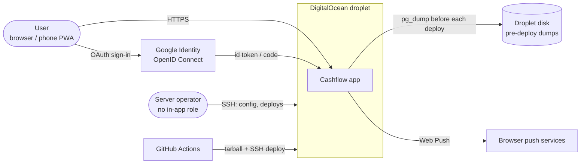
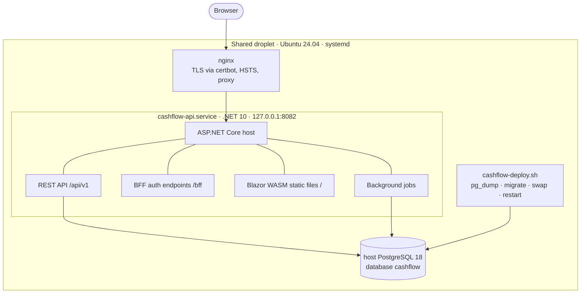
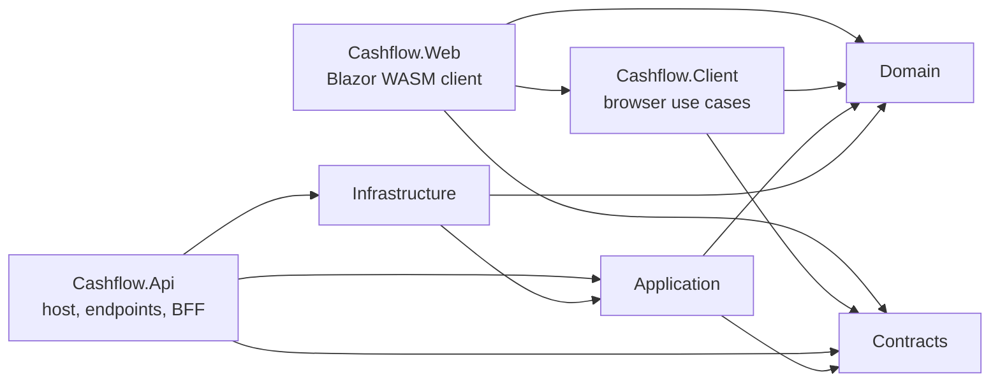
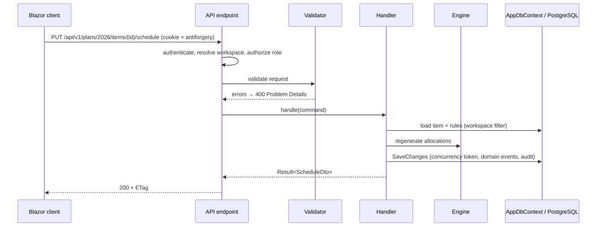

# Architecture Design

Part of the Phase 0 design set: [plan](cashflow-app-plan.md) · **architecture** · [database](database-design.md) · [API](api-design.md) · [UI](ui-design.md) · [engineering standards](engineering-standards.md)

---

## 1. Goals and constraints

| Driver | Consequence |
|---|---|
| Reachable from anywhere (phone and PC) | Hosted on a DigitalOcean droplet behind HTTPS; browser-based PWA client |
| Several users, each with their own data | Multi-tenant by **workspace**; isolation enforced in the app *and* in PostgreSQL |
| Every rule configurable (tax, contributions, buckets, schedules) | Rules are **versioned data**, evaluated by a pure calculation engine; no rule is hard-coded |
| Money correctness | `decimal` everywhere, one rounding rule, golden tests against the workbook |
| One developer, low running cost | Modular monolith, one container + PostgreSQL + reverse proxy on a single droplet |
| No email provider | No email features: invite links shared by hand, in-app notifications, Web Push |
| Google login | Sign in with Google (OIDC) only; no passwords stored; allow-list from a server setting plus workspace invites |
| No admin role | No in-app admin. Sign-in allow-list lives in server config; the Philippine base templates are seed data shipped with releases; users copy and edit them per workspace or as their own templates |
| Operator must not read users' pay | **End-to-end encryption**: sensitive data encrypted in the browser; server stores ciphertext; engine runs client-side — see [privacy-encryption.md](privacy-encryption.md) |

Non-goals: microservices, message brokers, multi-region, bank integrations.

---

## 2. System context (C4 level 1)



## 3. Containers (C4 level 2)



- **One app process** serves the API, the BFF auth endpoints and the Blazor WebAssembly client (static files) from the same origin. It is a framework-dependent publish run by the host's .NET 10 runtime as a hardened systemd service (user `cashflow`, no writable directories, 350 MB memory cap).
- **PostgreSQL** is the host's instance, reached on `127.0.0.1` only (scram-sha-256); the app has its own database `cashflow` and two roles (`cashflow_owner` for migrations and dumps, `cashflow_app` for the app, subject to row-level security). Other databases on the host are never touched.
- **nginx** (already on the droplet) terminates TLS (certbot) with HSTS and proxies to the app. The Content-Security-Policy, `X-Content-Type-Options` and `Referrer-Policy` are set by the app itself, so a release never needs a proxy change.

---

## 4. Application architecture

### 4.1 Style

A **modular monolith** with **Clean Architecture** dependency rules, organised **by feature (vertical slices)** inside each layer. Kept deliberately thin:

- `DbContext` *is* the unit of work and `DbSet<T>` *is* the repository — no generic repository layer.
- No mediator library; each use case is a small handler class injected and called directly by its endpoint.
- Abstractions only where there is a real second implementation or a test seam (clock → `TimeProvider`, push sender, file storage).

### 4.2 Projects and dependencies



| Project | Responsibility | May reference |
|---|---|---|
| `Cashflow.Domain` | Entities, value objects (`Money`, `Percentage`, `PeriodRef`, `DateRange`), enums, domain errors, **calculation engine** (payroll, tax, contributions, schedules, allocation, transfers, interest, goals, debt) | nothing |
| `Cashflow.Application` | Server feature slices over plain metadata and encrypted envelopes: sign-in provisioning, workspaces and members, invites, key envelopes, encrypted record CRUD, change feed, notifications; validators, authorization requirements, interfaces for infrastructure (`IPushSender`) | Domain, Contracts |
| `Cashflow.Infrastructure` | EF Core `AppDbContext` (Npgsql), configurations, migrations, RLS interceptor, Google sign-in user provisioning, Data Protection keys, Web Push, background job runner, seeding of the Philippine base templates | Application, Domain |
| `Cashflow.Client` | Browser-side use cases over decrypted records (planner, payday, payroll, import/export with Open XML SDK, reports); record encryption/decryption through an `ICrypto` port implemented in `Cashflow.Web` | Domain, Contracts |
| `Cashflow.Contracts` | Request/response DTOs, enums shared with the client, API route constants | nothing |
| `Cashflow.Api` | `Program.cs`, endpoint groups, BFF, auth, rate limiting, OpenAPI, Problem Details, health checks, hosts the WASM files | Application, Infrastructure, Contracts |
| `Cashflow.Web` | Blazor WebAssembly PWA: pages, components, typed API client, state | Contracts |

The dependency rule is enforced by a **NetArchTest** test (see [engineering-standards.md §4](engineering-standards.md#4-testing-standards)).

### 4.3 Feature folder layout

```
src/Cashflow.Application/
└─ Features/
   ├─ TaxTables/
   │  ├─ CreateTaxTable.cs        // Command record + Validator + Handler in one file
   │  ├─ CloneTaxTable.cs
   │  ├─ UpdateTaxBrackets.cs
   │  ├─ GetTaxTable.cs           // Query + Handler
   │  └─ ListTaxTables.cs
   ├─ Contributions/ … ├─ PayrollProfiles/ … ├─ Plans/ … ├─ Planner/ …
   ├─ Payday/ … ├─ Goals/ … ├─ Debts/ … ├─ Accounts/ … ├─ NetWorth/ …
   └─ Import/ …
src/Cashflow.Api/
└─ Endpoints/
   ├─ TaxTableEndpoints.cs        // MapGroup("/api/v1/tax-tables")
   └─ …
```

One file per use case keeps the request, validation and handling of a feature together and easy to find.

### 4.4 Design patterns used (and why)

| Pattern | Where | Why |
|---|---|---|
| **Strategy** | `ITaxCalculator` (bracket table, flat rate, none, manual), `IContributionMethod` (percentage with floor/ceiling, bracket lookup, fixed), `ISplitMode` (even, P1, P2, custom, spread), `ITaxSplitMethod` (workbook, even, P1, P2, manual) | The core of "everything configurable": the rule row names its method; the engine picks the strategy |
| **Specification / effective-dated lookup** | `RuleSet.EffectiveOn(date)` for tax tables, contribution schemes, salary profiles, schedule rules, interest rates | Changing a rule from July never rewrites January |
| **Template + copy-on-write** | Seeded Philippine base (PH TRAIN tax, SSS, PhilHealth, Pag-IBIG, default categories) copied into a workspace or a user's own templates | Users edit their copy; new base versions from a release are offered, never forced |
| **Result pattern** | Handlers return `Result<T>` with typed `Error` (Validation, NotFound, Conflict, Forbidden) | No exceptions for expected failures; maps 1:1 to Problem Details |
| **Value objects** | `Money`, `Percentage`, `PeriodRef`, `DateRange` | Rounding, currency and range rules live in one place |
| **Aggregate roots** | `PlanYear` (periods), `TaxTable` (brackets), `ContributionScheme` (tiers), `PayPeriod` (allocations, transfers, status) | Invariants (non-overlapping brackets, closed periods read-only) enforced in one place |
| **Materialized projection** | `allocation` rows generated from schedule rules | Fast grid; history kept; overrides survive regeneration |
| **Domain events (in-process)** | `PeriodClosed`, `AllocationPaid`, `TransferCompleted` → update balances, goals, debts, notifications | Keeps side effects out of handlers; dispatched in the same transaction via an EF `SaveChanges` interceptor |
| **Outbox (light)** | `job` table for push notifications and snapshots | Reliable background work without a broker |
| **BFF** | `/bff/login` (challenges Google), `/signin-google` (callback), `/bff/logout`, `/bff/user`; app cookie auth for API calls | No tokens in the browser; same-origin; CSRF protection |
| **Options pattern** | `IOptions<T>` with validation on start for every config section | Fail fast on bad configuration |

### 4.5 Calculation engine

Pure functions in `Cashflow.Domain/Engine`, no I/O, fully deterministic:

```csharp
public sealed class PayrollEngine(ITaxStrategyFactory taxes, IContributionMethodFactory contributions)
{
    public Payslip Compute(PayrollInput input)   // profile + period + effective rule set
    {
        var lines = contributions.ComputeAll(input.Schemes, input.Gross);
        var taxable = TaxableIncome.From(input, lines);
        var tax = taxes.For(input.TaxRule).Compute(taxable, input.PeriodBasis);
        var split = TaxSplit.For(input.SplitMethod).Split(tax, input.Period);
        return Payslip.Build(input, lines, split);
    }
}
```

Every result carries an **explanation trace** (`Explain()` → list of steps with values, e.g., "Bracket ₱800,000–₱2,000,000: ₱102,500 + 25% × ₱112,600"). The UI shows this when the user clicks a number, which replaces "click the cell to see the formula".

### 4.6 Request flow



### 4.7 Multi-tenancy

- A user belongs to one or more **workspaces** with a role (Owner, Editor, Viewer). The active workspace is a claim set at sign-in and switched with `POST /bff/workspace`; API routes therefore don't repeat a workspace id.
- `AppDbContext` applies a **global query filter** `WorkspaceId == current` on every tenant table, and sets `SET LOCAL app.workspace_id` per transaction so PostgreSQL **row-level security** policies block any query that slips past the filter.
- Template levels: the **seeded base** (`workspace_id` and `owner_user_id` NULL) is readable by everyone and writable by nobody through the app — only seed migrations in a release change it; **personal templates** (`owner_user_id` set) belong to one user and are encrypted with that user's key; **workspace copies** (`workspace_id` set) are what plans use, encrypted with the workspace key.

### 4.7.1 End-to-end encryption changes the split of work

With E2EE ([privacy-encryption.md](privacy-encryption.md)) the server never sees amounts, names or notes, so:

- **`Cashflow.Domain` (engine) and the feature logic run in the Blazor WebAssembly client.** The client project references `Cashflow.Domain` and the client-side `Cashflow.Client` class library (use cases over decrypted records, unit-testable without Blazor); a `Crypto` module in `Cashflow.Web` wraps WebCrypto via `[JSImport]`.
- **Storage shape:** each sensitive table keeps its plain metadata columns (ids, FKs, dates, statuses) and stores the rest in `payload`/`nonce`/`key_version` ([database-design.md §10](database-design.md#10-end-to-end-encryption)), so FKs, unique keys and the schedule exclusion constraint stay in PostgreSQL. There is no single generic record table; `EncryptedRecord` above is the wire shape, not the storage shape.
- **The server becomes a sync and policy service**: authentication, workspace membership, key-envelope storage, encrypted-record CRUD with metadata validation, change feed, invites, notifications from plain dates, serving the seeded base templates.
- Server-side `Application` handlers keep the same slice structure, but operate on record envelopes (`EncryptedRecord { Id, Kind, WorkspaceId, Metadata, Payload, Nonce, KeyVersion }`) instead of amounts.
- The request flow in §4.6 applies to metadata; content validation happens in the browser before encryption.

### 4.8 Background jobs

`BackgroundService` polling a `job` table (`SELECT … FOR UPDATE SKIP LOCKED`), retries with backoff:

| Job | Schedule |
|---|---|
| Payday reminder (in-app + Web Push) | Morning of each pay date |
| Due-date reminders for items/sinking items | Daily 07:00 workspace time |

Net-worth snapshots and interest estimates need amounts, so they are **not** server jobs: the browser computes and saves them on the first visit after the 1st of the month (privacy-encryption.md §4). Server jobs use plain dates only.
| Expired invite/reset link cleanup | Daily |

Database backups run in the separate backup sidecar, not in the app.

---

## 5. Deployment

### 5.1 Droplet

Cashflow shares an existing small droplet (see ADR 0014); nothing new is installed except the app itself.

| Item | Choice |
|---|---|
| Size | The existing Basic droplet (512 MB RAM, swap on): the app is capped at 350 MB; resize to 1 GB if it gets slow |
| OS | Ubuntu 24.04 LTS, unattended security upgrades, SSH keys only (already in place) |
| Runtime | Host .NET 10 runtime (`/usr/lib/dotnet`, no SDK), host PostgreSQL 18, host nginx + certbot |
| Users | `cashflow` (system, nologin, runs the app) and `cashflow-deploy` (key-only SSH; may run exactly `systemctl restart cashflow-api` through sudo) |
| Layout | `/opt/cashflow/releases/<tag>/`, `current` symlink, `config/google.env`; secrets in `/etc/cashflow/cashflow.env` (root:cashflow 0640) |
| Backups | `pg_dump -Fc` before every migration into `/var/backups/cashflow` (newest 10 kept); optional DigitalOcean droplet Backups for an off-box copy |

### 5.2 Services

One systemd unit, `cashflow-api.service` (`deploy/server/cashflow-api.service`): `ExecStart=/usr/lib/dotnet/dotnet /opt/cashflow/current/Cashflow.Api.dll`, `ASPNETCORE_URLS=http://127.0.0.1:8082`, `EnvironmentFile` for the secrets, `MemoryMax=350M`, `Restart=on-failure`, and sandboxing (`NoNewPrivileges`, `ProtectSystem=strict`, `ProtectHome`, `PrivateTmp`, empty capability set; no `MemoryDenyWriteExecute` because of the JIT). No timers and no other long-running services are added. `deploy/server/bootstrap-droplet.sh` (run once as root, `--dry-run` first) sets everything up idempotently.

### 5.3 CI/CD

```mermaid
flowchart LR
  pr[Pull request] --> ci[CI: restore · build · format check · analyzers · unit + integration tests (Testcontainers) · coverage gate · e2e · deploy script tests]
  tag[Tag vX.Y.Z on green main] --> pub[Publish linux-x64 · idempotent migration SQL · tarball] --> dep[SSH: upload · pg_dump · migrate in one transaction · swap current · restart · health check] --> smoke[Smoke test https://domain/health/ready]
  dep -- fail --> rb[Point current back at the previous release]
```

- Migrations are applied as **idempotent SQL scripts** (`dotnet ef migrations script --idempotent`) by the deploy script as `cashflow_owner`, never automatically at app start; they are expand-only so the previous release keeps working after a rollback.
- A database dump is taken immediately before every migration and the deploy fails if the dump fails (the very first deploy has nothing to dump).
- The server script that runs is installed (root-owned) by the bootstrap, not taken from the release.

### 5.4 Environments

| Env | Where | Data |
|---|---|---|
| Local | `docker compose -f deploy/compose.dev.yml up` (Postgres) + `dotnet watch` | Seeded sample workspace |
| CI | GitHub Actions + Testcontainers | Ephemeral |
| Production | Shared droplet | Real |

A staging environment is optional (a second service and database on the same droplet) once there are other users.

---

## 6. Observability

- **Logs:** Serilog, structured JSON to stdout (Docker log rotation 10 MB × 5); request logging with trace id; **no amounts, names or notes in logs** — ids only.
- **Traces/metrics:** OpenTelemetry (ASP.NET Core, HttpClient, Npgsql); optional export to a hosted OTLP endpoint; built-in `/metrics` disabled publicly.
- **Health:** `/health/live` (process), `/health/ready` (database + migrations applied).
- **Errors:** Problem Details with `traceId`; unhandled exceptions logged once by the global handler.

---

## 7. Security

| Threat | Control |
|---|---|
| Account takeover | No local passwords: Google handles credentials, 2-step verification and recovery; app validates the OIDC response (state, nonce, PKCE via the Google handler), requires `email_verified`, and keys users by Google `sub` (not email) |
| Unwanted sign-ups | Allow-list: emails in the server setting `Auth__AllowedEmails`, or a single-use invite link (7 days) created by a workspace owner; any other Google account is rejected with "no access". Revoke by removing the member from the workspace or the email from the setting; there is no admin role |
| Session theft / CSRF | `HttpOnly` + `Secure` + `SameSite=Strict` cookie, antiforgery header on unsafe methods, short idle timeout option |
| Cross-tenant access | Query filters + PostgreSQL RLS + authorization handlers + integration tests that try cross-workspace reads |
| Injection | EF Core parameterised queries only; raw SQL forbidden outside migrations and reviewed RLS setup |
| XSS | Blazor encodes output; strict Content-Security-Policy set by the app; no `MarkupString` from user data |
| Data at rest | Droplet volume encryption (DigitalOcean default), Data Protection keys in the database encrypted with a certificate, data payloads are end-to-end encrypted ciphertext (so the dumps are too) |
| Secrets leakage | `/etc/cashflow/cashflow.env` generated on the droplet (never in the repo), GitHub secret scanning, `dotnet user-secrets` locally |
| Dependency risk | Dependabot, `dotnet list package --vulnerable` in CI, image scan |
| Loss of data | Nightly encrypted off-site backups, pre-migration backup, monthly restore drill |

---

## 8. Architecture decision records

Kept in `docs/adr/NNNN-title.md` (MADR format). Initial set:

| ADR | Decision |
|---|---|
| 0001 | Modular monolith with Clean Architecture boundaries and vertical slices |
| 0002 | PostgreSQL on the droplet (originally a Docker container; superseded by 0014: the host's PostgreSQL 18), managed DB as a later option |
| 0003 | Blazor WebAssembly + BFF cookie auth on one origin |
| 0004 | Rules as versioned data: seeded Philippine base (read-only, release-shipped) + personal templates + workspace copies, copy-on-write |
| 0012 | No admin role: allow-list in server config, base templates updated only by releases |
| 0005 | No mediator or repository libraries; handlers + DbContext |
| 0006 | Multi-tenancy by workspace with RLS as defence in depth |
| 0007 | No email; invite links, in-app + Web Push notifications |
| 0009 | Sign in with Google (OIDC) only, allow-listed; app-issued BFF cookie session |
| 0010 | Tailwind CSS v4 + in-house Blazor component library instead of a component suite (MudBlazor rejected) |
| 0011 | End-to-end encryption of financial data; keys only in the browser (passkey PRF / passphrase + recovery key); calculations client-side |
| 0008 | Money as `decimal`/`numeric(18,2)`, half-away-from-zero rounding at stored values |
| 0013 | Hand-written typed API client; browser-side `Cashflow.Client` use-case library; per-table encrypted storage; workbook import/export in the browser (Open XML SDK) |
| 0014 | Host on the shared droplet with systemd + nginx + the host PostgreSQL 18; the Docker deploy is dropped |
