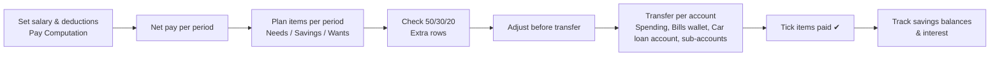

# Cashflow Management App — Product & Technical Plan

| | |
|---|---|
| **Status** | Draft v2 — planning + design (Phase 0), no code yet |
| **Date** | 2026-11-21 (v2: PostgreSQL on a DigitalOcean droplet, multi-user, everything configurable) |
| **Design docs** | [architecture.md](architecture.md) · [database-design.md](database-design.md) · [api-design.md](api-design.md) · [ui-design.md](ui-design.md) · [engineering-standards.md](engineering-standards.md) · [privacy-encryption.md](privacy-encryption.md) |
| **Source** | `budget-workbook.xlsx` (sheets: *Cash Flow*, *Pay Computation*) |
| **Goal** | Replace the yearly cash flow workbook with an app that plans, executes and tracks a full year of income, needs, savings and wants — per pay period |

> **Sample data:** figures in this document are sample data.

---

## Table of contents

1. [Why an app](#1-why-an-app)
2. [What the workbook does today](#2-what-the-workbook-does-today)
3. [Problems found in the workbook](#3-problems-found-in-the-workbook)
4. [Product vision and scope](#4-product-vision-and-scope)
5. [Domain model (concepts)](#5-domain-model-concepts)
6. [Functional requirements by module](#6-functional-requirements-by-module)
7. [Calculation specifications](#7-calculation-specifications)
8. [Data model](#8-data-model)
9. [Architecture and tech stack](#9-architecture-and-tech-stack)
10. [Screens and UX](#10-screens-and-ux)
11. [Excel migration and import](#11-excel-migration-and-import)
12. [Security, privacy and backups](#12-security-privacy-and-backups)
13. [Testing strategy](#13-testing-strategy)
14. [Roadmap and milestones](#14-roadmap-and-milestones)
15. [Open questions](#15-open-questions)
16. [Appendix A — Philippine payroll reference tables](#appendix-a--philippine-payroll-reference-tables)
17. [Appendix B — Workbook cell map](#appendix-b--workbook-cell-map)
18. [Appendix C — Golden values for parity tests](#appendix-c--golden-values-for-parity-tests)

---

## 1. Why an app

The workbook works, but it is held together by hand-maintained formulas:

- Every month is four hard-wired columns (Period 1 amount, Period 1 ✔, Period 2 amount, Period 2 ✔), repeated 12 times, so a change "from July onward" means editing up to 24 cells per line item.
- Subtotals are fixed `SUM` ranges that silently skip rows when items are added (two real cases below).
- The tax bracket used in *Pay Computation* is typed in by hand and must be changed if the salary crosses a bracket.
- The *Net Worth* and *Settings* sheets were deleted, which broke 13 named ranges, the savings-interest calculator and all the color-coded goal indicators (`#REF!` everywhere in columns BE–DE).
- There is no history: when a value is overwritten, last month's plan is gone.

The app keeps the same mental model (a yearly plan split into semi-monthly paydays, a 50/30/20 split, a "where do I transfer money" list) but makes the structure data instead of cell positions.

---

## 2. What the workbook does today

### 2.1 Sheet: *Pay Computation* — salary, contributions and tax

| Area | What it holds |
|---|---|
| `B3:C9` | The TRAIN-law annual income tax table (₱250k and below = 0%, up to over ₱8M = ₱2,202,500 + 35%). Text only, not used by formulas. |
| `B12:B14` | The bracket actually used, typed by hand: base tax ₱102,500, rate 25%, threshold ₱800,000. |
| `D12:D15` | Monthly gross income, SSS, PhilHealth, Pag-IBIG employee shares. |
| `G12` | Monthly tax **without** contributions: `((Gross×12 − threshold) × rate + base) / 12`. |
| `G13` | Monthly tax **with** contributions: `(((Gross − SSS − PhilHealth − PagIBIG)×12 − threshold) × rate + base) / 12`. |
| `G15:J19` | Per-period payslip: withholding tax, allowance, other deductions, net pay for Period 1, Period 2 and the month. |
| `K16:N19` | 50/30/20 check: target (net × 50/30/20%) vs. actual average from *Cash Flow*, with % variance. |
| `F23:F27` | Sinking-fund sub-items: Christmas Gifts, Gifts, Car Maintenance, Aircon Cleaning (names only). |
| `J22:O26` | Fund targets by phase, as multiples of monthly net pay: Sinking (1×, 3×, 6×), Emergency (3×, 6×, 12×), Medical (48×), Retirement (480×). |

Payslip rules the sheet encodes:

- Period 1 gets half the gross, **all** statutory contributions, its own allowance, and `tax with contributions − Period 2 tax`.
- Period 2 gets half the gross, its own allowance, and **half of the tax without contributions**.
- Net pay = gross/2 − contributions (P1 only) + allowance − (withholding + other deductions).

### 2.2 Sheet: *Cash Flow* — the yearly plan

**Layout**

| Columns | Meaning |
|---|---|
| `B:C` | Line number and item name (groups use a computed label such as `Utilities (₱3,649.50)`). |
| `D` | The item's default **monthly** amount (the template). |
| `H:K`, `L:O`, … `AZ:BC` | One block per month: P1 amount, P1 paid ✔, P2 amount, P2 paid ✔. |
| `BE:BF` | Notes and goals (broken references). |
| `BH:DE` | Savings-interest tracker: daily balances per account per month. |

**Rows**

| Row(s) | Content |
|---|---|
| 1 | Net pay per period (linked to *Pay Computation*). `C1`/`D1` = average P1/P2 pay. |
| 3 | "Net Income" — actually the **unallocated remainder**: pay − (Needs + Savings + Wants). |
| 4–26 | **NEEDS**: House (Rent) · Utilities (Electricity, Internet, Mobile plan) · Groceries (Groceries, Toiletries, Family support, Medicine) · Work (Allowance, Transportation) · Car (Loan, Insurance, Vehicle registration). |
| 28–46 | **SAVINGS**: Savings (Emergency Fund, Sinking Fund, Travel Fund, Family emergency fund, House fund, Personal allowance, Special savings) · Investments (Investment fund) · Insurance (empty). |
| 48–64 | **WANTS**: Subscriptions (Streaming, Email service, Game subscription) · Loans (Credit card A, Credit card B, Credit card C, Salary loan) · Others (Adjustments, Card annual fee, Transfer fee). |
| 66–68 | "Extra" rows: (net pay × 50%/30%/20%) − actual bucket total, per period. |
| 70 | Reminder banner: "Adjust before transferring!". |
| 72–76 | **Transfer list** per period: how much to send to Spending, Bills wallet, Car loan account, Sinking fund and Travel fund, each with a ✔ for "transferred". The Sinking fund and Travel fund transfers are marked "From Spending →", so Spending's total already includes them. |

**Item behaviours seen across the year** (these drive the scheduling design):

| Behaviour | Examples |
|---|---|
| Even split, every period | Electricity, Groceries, Car Loan, Sinking Fund (monthly ÷ 2). |
| Once a month, P1 only | Streaming, Email service, Game subscription. |
| Ends mid-year | Car Insurance (Jan–Jun), Credit card B (paid off after Jun), Email service (cancelled after Aug). |
| Amount changes from a month onward | Internet changes to ₱650/period from November; Salary loan amortization changes in July. |
| Seasonal bump | Groceries/Family support/Allowance up in Nov–Dec. |
| One-off override | January Internet P1 ₱1,200 instead of ₱600; January net pay differs from the rest of the year. |
| Planned but empty | Emergency Fund, Family emergency fund, House fund, Special savings, Investment fund (₱0). |

**Funding-account routing** (from the transfer formulas in rows 72–76):

| Account | Items it pays |
|---|---|
| Spending | Electricity, Groceries, Toiletries, Family support, Medicine, Allowance, Transportation, Personal allowance, Salary loan, plus the two sub-account transfers |
| Bills wallet | Internet, Mobile plan, Investment fund, Streaming, Email service, Game subscription, Credit card A, Credit card B, Credit card C |
| Car loan account | Car Loan, Car Insurance |
| Sinking fund, via Spending | Vehicle registration, Sinking Fund, Card annual fee |
| Travel fund, via Spending | Travel Fund |
| *(not routed)* | Rent, Transfer Fee, Adjustments, empty savings items |

**Savings-interest tracker (BH:DE)** — for each month and each interest-bearing account (Savings A, Savings B, Savings C, Savings D): one row per day with the end-of-day balance (often typed as arithmetic like `=1870.33+15.74-3.15`), then the average daily balance (ADB), `interest = ADB × annual rate × days / 360` and a final-tax line (`− interest × 20%`). Rates came from the deleted *Settings* sheet.

**Goals and net worth (BE:BG, broken)** — "Get out of CC debt", "Monthly Goal (Savings B): ₱50", "Positive Net Worth", a ₱50,000 threshold indicator, "2021 SAVINGS / 2021 GOAL" blocks. Named ranges `SavingsFund1/2`, `EmergencyFund`, `ExpensesFund`, `Loan`, `CCDebt`, `Stocks`, `StocksEarnings`, `Crypto`, `EMoney`, `NetWorthAsset`, `NetWorthLiability`, `NetWorth2020` all point to `#REF!`.

### 2.3 The workflow the workbook supports



The app must support this exact payday loop first; everything else builds on it.

---

## 3. Problems found in the workbook

These are real defects found while reading the formulas. The app fixes them structurally (totals are computed from data, not ranges).

| # | Problem | Cell(s) | Effect |
|---|---|---|---|
| 1 | Loans subtotal is `SUM(H55:H56)` but the group spans rows 55–58. | `H54`, `J54`, … every month | Credit card C and Salary loan (₱1,750.00 + ₱904.55 per period in H1) are **left out of Wants**, so the Wants % and the unallocated remainder are overstated by ~₱2,655 per period. The group label (`D55:D59`) does include them, so label and totals disagree. |
| 2 | Others subtotal is `SUM(H61:H62)`, group spans 61–64. | `H60`, … | Transfer fee (₱250/period) is excluded from Wants. |
| 3 | Transfer fee is not routed to any account. | rows 72–76 | It is planned but never funded. |
| 4 | Tax bracket typed by hand. | `B12:B14` | Wrong tax if gross pay moves to another bracket. |
| 5 | Deleted *Net Worth* / *Settings* sheets. | `BF`, `BG`, `BI60:DE61`, 13 named ranges, all goal conditional formats | Interest, net worth and goal indicators no longer work. |
| 6 | Savings-interest balances are typed as arithmetic. | `BI4`, `BK4`, … | No transaction history; mistakes are invisible. |
| 7 | Annual tax projection = current month × 12. | `G12:G13` | Ignores salary changes mid-year (January differs), 13th-month pay, bonuses and the ₱90,000 exemption; no year-end true-up. |
| 8 | No history or audit. | everywhere | Overwriting a cell loses the previous plan. |
| 9 | Unallocated remainder is called "Net Income". | row 3 | Misleading label; the app calls it **Unallocated**. |

When importing, the app reports these differences so the totals can be checked by eye (see §11.4).

---

## 4. Product vision and scope

### 4.1 Vision

*"Open the app on payday, see exactly how much goes to each account and what gets paid, tick it off, and know — at any moment — whether the year is on track for needs, savings, wants, debts and goals."*

### 4.2 Users

- **Primary:** one person managing their own salary and household cash flow in the Philippines (PHP, semi-monthly pay).
- **Other users:** the app is hosted and reachable from anywhere, so anyone given an account gets their own **workspace** with their own tax tables, contribution rules, categories, accounts and plans. Nothing is shared between workspaces.
- **Later (optional):** a partner or family member invited into a workspace with a role (Owner / Editor / Viewer).

### 4.2.1 Configurability principle (applies to every module)

**Every rule has a default and an override.** There is **no admin role**. Templates exist at three levels:

1. **Philippine base (seeded):** shipped with the app as read-only seed data (PH TRAIN tax table, SSS, PhilHealth, Pag-IBIG, earning/deduction types, 50/30/20 buckets, starter categories, semi-monthly schedule, PH holidays). Nobody edits it in the app; new versions (e.g. 2027 rates) arrive only with an app release.
2. **My templates (per user):** a user's own reusable rule sets (a custom tax table, a contribution set, a category set), created from scratch or copied from the base, usable in any of their workspaces.
3. **Workspace copies (in use):** what a workspace's salary profiles and plans actually use; created by copying the base or a personal template, then edited freely.

When a release brings a new base version, users see "New Philippine rates available" and choose whether to copy it into their workspace as a new effective-dated version; nothing changes on its own.

What can be configured:

| Area | Default (seeded Philippine base) | What a user can do |
|---|---|---|
| Income tax | Philippines — TRAIN law table (2023+) | Use it as is · clone and edit brackets · create a fully custom table (any country, any period basis) · use a flat rate · no tax · type a manual tax amount per payslip |
| Contributions | SSS, PhilHealth, Pag-IBIG (PH 2025+) | Edit rates/floors/caps · disable one · add their own (union dues, HMO, retirement plan) using one of the calculation methods: % with floor/ceiling, bracket table, fixed amount |
| Earnings & deductions | Basic pay, allowance, 13th month, loans | Create their own types, each with taxable / pre-tax / which-period flags |
| Tax split per period | "Workbook" method (P2 = ½ tax without contributions) | Even split · all in P1 · all in P2 · manual |
| Buckets | Needs 50 / Savings 30 / Wants 20 | Rename, add or remove buckets, change % (must total 100), or turn targets off |
| Pay schedule | Semi-monthly, 15th & end of month | Monthly, bi-weekly, weekly, custom dates; weekend/holiday rule |
| Currency & locale | PHP, en-PH | Any ISO currency and locale per workspace |
| Fund targets | Phases as months of net pay (1/3/6, 3/6/12, 48, 480) | Fixed amounts, other bases, own phases |
| Interest | 360-day basis, 20% final tax | Per-account basis, rate history, tax rate |

Rules are **versioned by effective date**, so changing a rate in July never rewrites January. A new seeded base version is offered as "update available — review changes"; it never overwrites a workspace's edited copy.

### 4.3 In scope

1. Salary & payroll calculator (PH statutory contributions + TRAIN withholding tax), salary history and payslip log.
2. Yearly plan of all incoming and outgoing money, per pay period, with recurring items and overrides.
3. 50/30/20 (or custom) allocation targets vs. plan vs. actual.
4. Payday checklist: received pay, per-account transfer instructions, paid ✔ per item.
5. Savings goals and funds (sinking, emergency, medical, retirement, travel, house, custom) with phased targets.
6. Debts (credit cards, car loan, salary loan) with payoff tracking.
7. Accounts and balances, including average-daily-balance interest estimates with final tax.
8. Net worth snapshots (assets − liabilities).
9. Reports and dashboard.
10. Import of the existing workbook; export to Excel/CSV; full backup/restore.
11. Year rollover (create 2027 from 2026).

### 4.4 Out of scope (for now)

- Direct bank or e-wallet integration (most banks and e-wallets offer no API access; manual entry and CSV import instead).
- Receipt-level expense tracking for every purchase (item-level actuals are enough to replace the workbook; transaction-level spending is a later phase).
- Filing taxes (the app *estimates* withholding and annual tax; it does not file BIR forms).
- Investment advice.

### 4.5 Success criteria

- The 2026 workbook imports and the app reproduces its per-period numbers (net pay, bucket totals, transfer amounts) — except where §3 defects are fixed, and those differences are listed.
- A payday takes under 2 minutes in the app: confirm pay → review → transfer list → tick.
- A change like "Internet is ₱1,300/month from November" is one edit, not 4+ cell edits.
- No `#REF!` class of failure: deleting an account or item is blocked or handled explicitly.

---

## 5. Domain model (concepts)

| Concept | Meaning | Workbook equivalent |
|---|---|---|
| **Plan Year** | A calendar year's plan with its pay periods, rules and items. | The whole file |
| **Pay Period** | One payday window. Default: two per month (P1 ≈ 15th, P2 ≈ end of month). 24 per year. | `H:I`, `J:K` per month |
| **Income Source** | Employer, side job, interest, other. | — |
| **Salary Profile** | Gross pay, allowances, deduction rules, effective from a date. Versioned. | *Pay Computation* `D12:D15`, `G17:H18` |
| **Payslip (computed)** | Expected gross, contributions, tax, allowances, net per period. | *Pay Computation* `G16:J19` |
| **Payslip (actual)** | What was actually received, entered from the real payslip. | — (new) |
| **Bucket** | Needs, Savings, Wants (fixed set, targets configurable). | NEEDS / SAVINGS / WANTS rows |
| **Allocation Rule** | Target % per bucket (default 50/30/20). | `J19*0.5/0.3/0.2`, rows 66–68 |
| **Category** | A group inside a bucket (Utilities, Car, Subscriptions…). | Group rows (5, 8, 13…) |
| **Budget Item** | A recurring line (Electricity, Streaming…) with default account and links. | Item rows |
| **Schedule Rule** | How much an item costs and when, effective from/to a period. | Column D + manual edits |
| **Allocation** | Planned amount of one item in one period, with actual amount and status. | One amount cell + its ✔ |
| **Account** | Where money sits: bank, e-wallet, savings, investment, credit card, loan. | Spending, Bills wallet, Car loan account, Sinking fund, Savings A… |
| **Funding Route** | Which account pays an item; which account feeds another (Sinking fund via Spending). | Transfer formulas rows 72–76 |
| **Transfer** | Instruction "send ₱X to account Y this period", with done ✔. | Rows 72–76 + ✔ |
| **Goal / Fund** | A savings target (amount or months-of-pay multiple) with phases and progress. | `J22:O26`, BE notes |
| **Sinking Sub-item** | A planned irregular expense inside the sinking fund (Christmas gifts, aircon cleaning). | *Pay Computation* `F23:F27` |
| **Debt** | A liability with balance, payment and payoff date. | Loans group, Car loan |
| **Transaction** | A dated movement on an account (deposit, withdrawal, interest, tax). | Daily balance arithmetic |
| **Net Worth Snapshot** | Assets and liabilities at a date. | Deleted *Net Worth* sheet |

---

## 6. Functional requirements by module

Priority: **M** = MVP (roadmap Phase 2), **P2/P3/P4** = later phase: P2 ships in roadmap Phase 3, P3 in Phase 4, P4 in Phase 5 (see §14 and [implementation-plan.md](implementation-plan.md)).

### 6.1 Settings & setup

| ID | Requirement | Pri |
|---|---|---|
| SET-1 | Create a Plan Year: year, pay frequency (semi-monthly default; also monthly, bi-weekly), pay days (e.g., 15 and last day; "if weekend, pay on the Friday before"). Generates the pay periods. | M |
| SET-2 | Currency PHP, `₱#,##0.00` format, Philippine locale (`en-PH`). | M |
| SET-3 | Allocation rule per year: Needs/Savings/Wants % (must total 100), default 50/30/20. | M |
| SET-4 | Manage accounts (name, institution, type, funding account yes/no, parent funding account, interest rate, interest tax rate, archived). | M |
| SET-5 | Manage categories and items (create, rename, reorder, move between categories, archive — never hard-delete items with history). | M |
| SET-6 | Statutory rate tables (SSS, PhilHealth, Pag-IBIG) and tax tables stored as **versioned data** by effective date, editable without code changes. | M |
| SET-7 | First-run wizard: import workbook **or** start from a template (the workbook's categories with ₱0 amounts). | M |

### 6.2 Salary, payroll & tax

| ID | Requirement | Pri |
|---|---|---|
| PAY-1 | Salary profiles with effective dates (salary history log): monthly gross, per-period allowances (non-taxable), other recurring deductions, which period takes contributions (P1 / split / P2), withholding split method. | M |
| PAY-2 | Compute SSS, PhilHealth and Pag-IBIG employee shares from the rate tables (with caps), allowing a manual override per profile. | M |
| PAY-3 | Compute withholding tax from the tax table automatically (bracket lookup — no hand-typed bracket). | M |
| PAY-4 | Reproduce the workbook's split: P2 tax = ½ × tax without contributions; P1 tax = tax with contributions − P2 tax. Offer an alternative "even split" method. | M |
| PAY-5 | Expected payslip per period → feeds the plan's income line automatically. | M |
| PAY-6 | What-if calculator: change gross/allowance and see net pay, tax, and the 50/30/20 amounts instantly without saving. | M |
| PAY-7 | Log actual payslips (gross, each deduction, net received). Show expected vs. actual and use **actual** for the period once logged. | P2 |
| PAY-8 | Extra income: 13th-month pay, bonuses, side income, interest — taxable flag, ₱90,000 exemption for 13th month & other benefits. | P2 |
| PAY-9 | Year-to-date tax tracker and year-end annualization: projected annual tax due vs. withheld so far, estimated refund/payable in December. | P2 |
| PAY-10 | Multiple income sources (second job, freelance) with their own rules. | P3 |

### 6.3 Annual planner (the spreadsheet replacement)

| ID | Requirement | Pri |
|---|---|---|
| PLN-1 | Grid view: rows = items grouped by bucket → category; columns = 24 periods (toggle to 12 months, or a single month's P1/P2). Frozen item column, sticky header, subtotals per category, bucket and period. | M |
| PLN-2 | Schedule rules per item: monthly amount + split mode (**Even**, **P1 only**, **P2 only**, **Custom P1/P2**), active months (e.g., Dec only), effective from/to period. | M |
| PLN-3 | "Change from here onward": editing a cell offers *this period only* (override) or *this and following periods* (new schedule rule). | M |
| PLN-4 | Overrides are highlighted; "reset to schedule" per cell or per row. | M |
| PLN-5 | Annual/irregular expenses (vehicle registration, card annual fee, aircon cleaning) can be entered as a yearly amount and spread across periods, or planned for the due month only. | M |
| PLN-6 | Income row per period (from payslip), Unallocated row (income − all allocations), and per-bucket target vs. planned rows (the workbook's "Extra" rows). | M |
| PLN-7 | Items link to an account (who pays), a goal (savings items) or a debt (loan/CC items) so balances update when ticked paid. | M (accounts), P2 (goals/debts) |
| PLN-8 | Keyboard-friendly editing: arrow keys, Enter, fill-right, copy/paste a row of amounts. | M |
| PLN-9 | Item notes (the workbook uses cell notes for context). | M |
| PLN-10 | Undo last change; change history per item (who/when/old/new). | P2 |
| PLN-11 | Warnings: unallocated < 0 for a period, bucket over target, item with no funding account. | M |

### 6.4 Payday (period execution)

| ID | Requirement | Pri |
|---|---|---|
| DAY-1 | "Current period" screen opens by default on payday. | M |
| DAY-2 | Step 1 — **Confirm pay**: expected net pay shown; enter actual received if different. | M |
| DAY-3 | Step 2 — **Adjust**: list of this period's allocations by bucket; edit amounts in place; unallocated amount and 50/30/20 status update live. (This is the "Adjust before transferring" step.) | M |
| DAY-4 | Step 3 — **Transfer**: per funding account, the total to send, showing nested routes (Spending total includes Sinking fund + Travel fund), with a copy-amount button and a ✔ per transfer. | M |
| DAY-5 | Step 4 — **Pay**: tick each item paid; optional actual amount and date; partial payment allowed. | M |
| DAY-6 | Period status: Not started → Transfers done → All paid → Closed. Closing locks the period (unlock possible). | M |
| DAY-7 | Unpaid items from a closed period can be carried over to the next period. | P2 |
| DAY-8 | Reminders/notifications on payday and on item due dates. | P4 |

### 6.5 Allocation (50/30/20) dashboard

| ID | Requirement | Pri |
|---|---|---|
| ALC-1 | Per period, month and year: target, planned and actual amount and % per bucket. | M |
| ALC-2 | Surplus/shortfall per bucket (the workbook's "Extra" rows) with color coding. | M |
| ALC-3 | Year view chart: stacked bars per month (Needs/Savings/Wants/Unallocated) against income line. | M |
| ALC-4 | Monthly average comparison like *Pay Computation* `K16:N19` (target vs. actual average, % variance). | M |

### 6.6 Goals & funds

| ID | Requirement | Pri |
|---|---|---|
| GOL-1 | Goal types: Sinking, Emergency, Medical, Retirement, Travel, House fund, Family emergency fund, Custom. | P2 |
| GOL-2 | Target method: fixed amount, **N × monthly net pay**, or N × monthly Needs total; optional target date. | P2 |
| GOL-3 | Phases with multipliers (default from workbook: Sinking 1/3/6, Emergency 3/6/12, Medical 48, Retirement 480 months) — editable. | P2 |
| GOL-4 | Progress = balance of the linked account(s) or sum of paid contributions; show current phase, % to next phase, ETA at current contribution rate. | P2 |
| GOL-5 | Sinking sub-items (Christmas Gifts, Gifts, Car Maintenance, Aircon Cleaning…) with amount and due month → suggested monthly contribution; withdrawals recorded against the sub-item. | P2 |
| GOL-6 | "Required contribution" suggestion feeding the planner (e.g., to reach ₱X by December you need ₱Y per period). | P3 |

### 6.7 Debts

| ID | Requirement | Pri |
|---|---|---|
| DBT-1 | Debts: credit cards, car loan, salary loan, personal; balance, rate, monthly payment, start/end, lender, linked payment item. | P2 |
| DBT-2 | Paying the linked item reduces the balance (principal/interest split optional). | P2 |
| DBT-3 | Payoff projection and payoff date; "debt-free" countdown; CC debt total (replaces the broken `CCDebt` goal). | P2 |
| DBT-4 | Snowball/avalanche what-if ordering. | P3 |

### 6.8 Accounts, balances & interest

| ID | Requirement | Pri |
|---|---|---|
| ACC-1 | Account balance = opening balance + transactions. Transfers and ticked payments create transactions automatically. | P3 |
| ACC-2 | Manual transactions (deposit, withdrawal, fee, interest, tax), CSV import per account. | P3 |
| ACC-3 | Reconcile: enter the balance shown by the bank app; the app records the difference as an adjustment. | P3 |
| ACC-4 | Interest estimate per month: average daily balance × annual rate × days ÷ basis (360 default) − final tax (20% default); compare with actual interest credited. Rate history per account (the workbook notes a rate change). | P3 |
| ACC-5 | Monthly interest goal per account (e.g., ₱50/month on Savings B) with indicator. | P3 |

### 6.9 Net worth

| ID | Requirement | Pri |
|---|---|---|
| NW-1 | Assets: account balances, investment fund, stocks, crypto, e-money, other manual assets (with value date). | P3 |
| NW-2 | Liabilities: debts from §6.7. | P3 |
| NW-3 | Monthly snapshot (automatic at month close + manual), net worth trend chart, "positive net worth" goal. | P3 |

### 6.10 Reports

| ID | Requirement | Pri |
|---|---|---|
| RPT-1 | Dashboard: current period card, year income vs. outflow, 50/30/20 gauge, top categories, goals, debts, net worth. | M (basic), P3 (full) |
| RPT-2 | Category and item breakdown by month/year; planned vs. actual variance. | P2 |
| RPT-3 | Year-end forecast: projected savings, debt remaining, unallocated total. | P2 |
| RPT-4 | Export any report/grid to Excel and CSV; print-friendly view. | P2 |

### 6.11 Import, export, backup, rollover

| ID | Requirement | Pri |
|---|---|---|
| IMP-1 | Import `budget-workbook.xlsx` (layout in §11 / Appendix B). | M |
| IMP-2 | Full backup/restore as a single file (database copy or JSON). Automatic daily backup. | M |
| IMP-3 | Export the plan back to an Excel workbook in a similar layout. | P2 |
| IMP-4 | Year rollover: copy categories, items, schedules (optionally +N%), accounts, goals and closing balances into a new Plan Year. | P4 |

---

## 7. Calculation specifications

All money uses `decimal`. Rounding: 2 decimals, **half away from zero** (matches Excel `ROUND`). Round at the stored-value level (allocation, payslip line, transfer), never in display only.

### 7.1 Statutory contributions (employee share, per month)

Parameters come from the rate table effective on the pay date (values for 2025–2026 in Appendix A).

```
SSS        = lookup MSC (monthly salary credit) for gross, capped at MSC_max
             employee_share = MSC × employee_rate            (incl. MPF portion above ₱20k MSC)
PhilHealth = clamp(gross, floor, ceiling) × total_rate ÷ 2
PagIBIG    = min(gross, fund_salary_cap) × employee_rate
```

Sample check (gross ₱80,000): SSS ₱1,750 (₱35,000 × 5%), PhilHealth ₱2,000 (₱80,000 × 5% ÷ 2), Pag-IBIG ₱200 (₱10,000 × 2%). ✔

Each profile can override any contribution with a fixed amount (employers sometimes differ).

### 7.2 Withholding tax (monthly, workbook-compatible method)

```
taxable_monthly      = gross − SSS − PhilHealth − PagIBIG − other_pre_tax_deductions
annual_taxable       = taxable_monthly × 12
bracket              = tax_table.find(annual_taxable)          // automatic, replaces B12:B14
annual_tax           = bracket.base + (annual_taxable − bracket.lower) × bracket.rate
tax_with_contrib     = annual_tax / 12
tax_without_contrib  = taxFor(gross × 12) / 12                   // used only for the split
```

Period split (method **"Workbook"**, default for the import):

```
P2_tax = round(tax_without_contrib / 2, 2)
P1_tax = round(tax_with_contrib − P2_tax, 2)
```

Alternative method **"Even"**: `P1_tax = P2_tax = tax_with_contrib / 2`.

Sample check: taxable ₱76,050 → annual ₱912,600 → ₱102,500 + 25% × ₱112,600 = ₱130,650/yr → ₱10,887.50/mo. Without contributions → ₱11,875/mo → P2 ₱5,937.50, P1 ₱4,950. ✔

### 7.3 Net pay per period

```
P1_net = gross/2 − (SSS + PhilHealth + PagIBIG)   [if contributions in P1]
         + P1_allowance − P1_tax − P1_other_deductions
P2_net = gross/2 + P2_allowance − P2_tax − P2_other_deductions
```

Contribution placement is a profile setting: `P1` (workbook), `P2`, or `Split` (half each).

Sample check: P1 = 40,000 − 3,950 + 10,000 − 4,950 = **₱41,100.00**; P2 = 40,000 + 8,000 − 5,937.50 = **₱42,062.50**. ✔

### 7.4 Annualization (phase 2)

At any date, `projected_annual_tax = taxFor(YTD taxable + remaining expected taxable + taxable bonuses above ₱90,000)`; `year_end_adjustment = projected_annual_tax − YTD withheld − remaining expected withholding`. Shown on the tax tracker; positive = expect extra deduction in December, negative = expect refund.

### 7.5 Planned amount of an item in a period

```
rule   = the item's schedule rule effective for the period (latest effective_from ≤ period)
if rule is null or month not in rule.active_months → 0
amount = Even:      rule.monthly / 2
         P1 only:   period is P1 ? rule.monthly : 0
         P2 only:   period is P2 ? rule.monthly : 0
         Custom:    period is P1 ? rule.p1 : rule.p2
         Spread:    rule.annual / periods_in_active_range
planned = override ?? round(amount, 2)
```

Allocations are **materialized** (stored) for the whole year so the grid is fast and history is kept. When a schedule rule changes, only non-overridden, non-closed periods are regenerated.

### 7.6 Totals and allocation check

```
category_total(p) = Σ planned of items in the category          // no fixed ranges → fixes §3 #1, #2
bucket_total(p)   = Σ category totals in the bucket
income(p)         = actual payslip net ?? expected net + other income in p
unallocated(p)    = income(p) − Σ bucket totals                  // workbook row 3
target(b, p)      = income(p) × rule.pct(b)
surplus(b, p)     = target(b, p) − bucket_total(b, p)            // workbook rows 66–68
bucket_pct(b)     = bucket_total(b) / income                     // workbook labels "NEEDS (50%)"
monthly_average(b)= average(P1 totals) + average(P2 totals)      // workbook D4/D28/D48
```

Planned, actual (paid amounts) and target are all computed; "actual" uses `actual_amount ?? planned` for paid items only.

### 7.7 Transfers per period

```
direct(a, p)   = Σ planned of items whose funding account is a, in period p
total(a, p)    = direct(a, p) + Σ total(child, p) for accounts whose parent route is a
transfer list  = accounts with no parent (sent from the payroll account), each showing its children
```

Sample check, Nov P2: Spending 15,764.55 (= 12,304.55 direct + Sinking fund 2,460 + Travel fund 1,000), Bills wallet 2,899.50, Car loan account 9,500.00. ✔
Items without a funding account are flagged (fixes §3 #3) and stay in the payroll account.

### 7.8 Savings interest (average daily balance)

```
balance(d) = opening + Σ transactions up to end of day d
ADB        = Σ balance(d) for d in month / days_in_month
interest   = round(ADB × annual_rate × days_in_month / day_basis, 2)   // day_basis default 360
tax        = round(interest × final_tax_rate, 2)                       // default 20%
net        = interest − tax
```

Rate history: use the rate effective on each day (weighted) when an account changes rates mid-month.

### 7.9 Fund targets and phases

```
base     = monthly net pay (average of the year's expected P1+P2) | monthly Needs total | fixed
target_k = base × phase_k.multiplier
progress = linked balance / current phase target
ETA      = remaining / average monthly contribution (last 3 months)
```

Sample check: base ₱83,162.50 → Sinking ₱83,162.50 / ₱249,487.50 / ₱498,975; Emergency ₱249,487.50 / ₱498,975 / ₱997,950; Medical ₱3,991,800; Retirement ₱39,918,000. ✔

### 7.10 Debt payoff

Fixed-payment amortization: `months = −log(1 − r·B/P) / log(1 + r)` (r = monthly rate, B = balance, P = payment); with r = 0, `months = B / P`. Credit cards: minimum payment rule optional; otherwise the planned item amount is used as the payment.

---

## 8. Data model

The full PostgreSQL design — schemas, every table and column, keys, indexes, constraints, multi-tenancy, versioned rule tables and the ER diagrams — is in **[database-design.md](database-design.md)**. Summary:

- **PostgreSQL 17**, one database, schemas by area: `identity`, `config` (tax/contribution/earning rules, templates), `plan` (years, periods, categories, items, schedules, allocations, transfers), `money` (accounts, transactions, goals, debts, net worth), `audit`.
- **Multi-tenant by workspace:** every user-owned row carries `workspace_id`; EF Core global query filters plus PostgreSQL row-level security as a second guard.
- **Rules are data:** tax tables, contribution schemes, earning/deduction types and allocation rules are versioned rows with `effective_from`/`effective_to`; the seeded Philippine base (read-only, `workspace_id` and `owner_user_id` NULL) is copied into a workspace or into a user's own templates, then edited there.
- Money is `numeric(18,2)`, rates `numeric(9,6)`, dates `date`, timestamps `timestamptz` (UTC), ids `uuid` (v7, time-ordered).
- Integrity rules from v1 still hold: archive instead of delete when history exists, non-overlapping schedule rules (enforced with an exclusion constraint), closed periods are read-only, bucket percentages total 100.

---

## 9. Architecture and tech stack

The full design is in **[architecture.md](architecture.md)** (system, layers, patterns, deployment), **[api-design.md](api-design.md)** (REST API) and **[ui-design.md](ui-design.md)** (UI architecture and screens). Summary:

| Layer | Choice |
|---|---|
| Runtime | .NET 10 LTS, C# 14 |
| API | ASP.NET Core Minimal APIs, REST `/api/v1`, OpenAPI 3.1 (built-in `Microsoft.AspNetCore.OpenApi`) + Scalar UI, RFC 9457 Problem Details, FluentValidation |
| UI | Blazor WebAssembly (PWA) served by the same host — **BFF pattern** (cookie auth, same origin, no tokens in the browser), styled with **Tailwind CSS v4** (standalone CLI in the build, no Node app) and an in-house Blazor component library — no third-party component suite |
| Data | EF Core 10 + Npgsql, **PostgreSQL 17**, migrations as idempotent SQL scripts in CI |
| Auth | **Sign in with Google only** (OpenID Connect via `Microsoft.AspNetCore.Authentication.Google`); no passwords stored. The app keeps a local `user` row keyed by Google's `sub` id, issues its own BFF session cookie, and applies workspace roles (Owner/Editor/Viewer). **No admin role**: who may sign in is a server setting (`Auth__AllowedEmails`) plus workspace invite links |
| Background jobs | `BackgroundService` + PostgreSQL-backed job table (period reminders, nightly snapshots); no extra broker |
| Email | **None.** The app sends no email. Invites are one-time links a workspace owner copies and shares; reminders are in-app notifications and optional Web Push (browser push, no email needed) |
| Excel | Open XML SDK, run **in the browser** (import and export), because the server never sees plaintext — see [privacy-encryption.md §4](privacy-encryption.md) |
| Observability | Serilog → console (JSON) + OpenTelemetry traces/metrics; health checks `/health/live`, `/health/ready` |
| Hosting | **DigitalOcean droplet** (Ubuntu 24.04 LTS, shared with other apps): systemd service behind the host nginx (certbot HTTPS) + the host PostgreSQL 18; `pg_dump` before every migration (ADR 0014) |
| CI/CD | GitHub Actions → build, test (Testcontainers PostgreSQL), publish a tarball → deploy over SSH on tag |

**Architecture style:** a modular monolith using Clean Architecture boundaries kept deliberately thin — `Domain` (entities + pure calculation engine), `Application` (feature slices: one handler per use case), `Infrastructure` (EF Core, Identity, Excel, jobs), `Api` (endpoints), `Web` (Blazor client), `Contracts` (DTOs shared by API and client). No repository-over-EF or mediator library: `DbContext` is the unit of work and handlers are called directly.

**Alternatives considered:** Blazor Server (simpler, but needs a constant connection — poor on mobile data); React + .NET API (two languages); a managed database (DigitalOcean Managed PostgreSQL, ~US$15/month) instead of Postgres in Docker — a good upgrade once the data matters more than the cost; the design does not change.

## 10. Screens and UX

### 10.1 Navigation

`Dashboard · Payday · Planner · Salary & Tax · Goals · Debts · Accounts · Net Worth · Reports · Settings` — plus a Plan Year switcher (2026 ▾) in the header.

### 10.2 Dashboard

```
┌ 2026 ▾ ─────────────────────────────────────────────────────────────┐
│ Next payday: Nov 30 (P2)   Expected ₱42,062.50   Unallocated ₱… ⚠   │
├──────────────────────┬──────────────────────┬───────────────────────┤
│ 50/30/20 this month  │ Year to date         │ Goals                 │
│ Needs   ■■■■■□ 49%   │ Income   ₱1.0M       │ Emergency  ▓▓░░ 28%   │
│ Savings ■□□□□□ 11%   │ Out      ₱…          │ Sinking    ▓▓▓░ 71%   │
│ Wants   ■□□□□□  8%   │ Saved    ₱…          │ Travel     ▓░░░ 20%   │
├──────────────────────┴──────────────────────┴───────────────────────┤
│ Income vs outflow by month (stacked Needs/Savings/Wants + income)   │
├─────────────────────────────────────────────────────────────────────┤
│ Debts: CC total ₱…  ·  Car loan ends …   ·  Net worth ₱… (▲)        │
└─────────────────────────────────────────────────────────────────────┘
```

### 10.3 Payday (the core screen)

A 4-step flow for the selected period:

```
Nov P2 · Nov 30, 2026                         [1 Pay] [2 Adjust] [3 Transfer] [4 Pay items]

1 Pay        Expected ₱42,062.50   Received [ 42,062.50 ]  ✔

2 Adjust     NEEDS     ₱20,759.50 / target ₱21,031.25   ✔ under
             SAVINGS   ₱ 4,500.00 / target ₱12,618.75   ⚠ ₱8,119 short of target
             WANTS     ₱ 3,154.55 / target ₱8,412.50
             Unallocated ₱13,648.45
             (expand a bucket to edit any item amount for this period only)

3 Transfer   Spending            ₱15,764.55  [copy] [✔]
               └ Sinking fund     ₱ 2,460.00  [copy] [✔]
               └ Travel fund      ₱ 1,000.00  [copy] [✔]
             Bills wallet        ₱ 2,899.50  [copy] [✔]
             Car loan account    ₱ 9,500.00  [copy] [✔]
             ⚠ Not routed: Transfer fee ₱250.00 (stays in payroll account)

4 Pay items  ☐ Electricity ₱2,500   ☐ Groceries ₱4,000   ☐ Car loan ₱9,500 …
             [Mark all transferred items paid]                 [Close period]
```

### 10.4 Planner

```
            │ Jan P1  Jan P2 │ Feb P1  Feb P2 │ … │ Dec P2 │ Year
────────────┼────────────────┼────────────────┼───┼────────┼─────────
Income      │ 38,500  38,500 │ 41,100  42,062 │   │ 42,062 │ …
▼ NEEDS     │ 21,100  20,500 │ …                                        (target row underneath)
  ▼ Utilities
    Electricity  2,500  2,500 │ 2,500  2,500 │ …        ● = override, ⌁ = schedule change
    Internet    ●1,200    600 │   600    600 │ … 650
  ▶ Groceries  (collapsed)
▼ SAVINGS   │ …
▼ WANTS     │ …
Unallocated │ …  (red if < 0)
```

- Click a cell → edit; prompt "This period only / From here onward".
- Row menu: edit schedule, change funding account, link goal/debt, notes, archive.
- Toggle: periods / months / quarters; show planned / actual / variance.

### 10.5 Salary & Tax

- **Profiles** list with effective dates (salary history).
- **Calculator** (left: inputs, right: live payslip P1/P2/monthly, tax bracket used, 50/30/20 amounts) — mirrors *Pay Computation*.
- **Payslips** log: expected vs. actual per period, difference highlighted.
- **Tax tracker** (P2): YTD withheld, projected annual tax, expected year-end adjustment.

### 10.6 Other screens

- **Goals:** cards with phase progress bars, ETA, linked accounts, sinking sub-items with due months.
- **Debts:** list with balance, payment, payoff date, progress; CC total.
- **Accounts:** balances, transaction register, reconcile, monthly interest (ADB, gross, tax, net, vs. actual).
- **Net worth:** assets/liabilities table, snapshot history chart.
- **Settings:** plan year, pay days, allocation rule, accounts & routes, categories, rate/tax tables, import/export/backup.

### 10.7 UX principles

- Numbers right-aligned, tabular figures, `₱` and thousands separators; negative in red with a minus sign.
- Every computed total is clickable to show what it is made of (replaces "click the cell to see the formula").
- Desktop first for the planner; Payday and Dashboard fully usable on a phone.
- Light/dark theme; keyboard shortcuts in the planner.

---

## 11. Excel migration and import

### 11.1 Approach

A one-time (re-runnable) importer reads **cell values** (not formulas, because many are broken) from the known layout, creates a Plan Year 2026, and produces an import report.

### 11.2 Mapping

| Workbook | App |
|---|---|
| *Pay Computation* `D12` | `SalaryProfile.MonthlyGross` (effective Feb 2026; January gets its own profile/override from `H1`/`J1` since it differs) |
| `D13:D15` | Contribution overrides (or verify equal to computed values) |
| `G17:H17` | `P1Allowance`, `P2Allowance` |
| `G18:H18` | Other deductions P1/P2 |
| `B12:B14` | Ignored (bracket is computed); used only to cross-check |
| `J22:O26` | `Goal` + `GoalPhase` multipliers (1, 3, 6 / 3, 6, 12 / 48 / 480 months of net pay) |
| `F23:F27` | `SinkingItem` names (amounts 0 until set) |
| *Cash Flow* group rows | `Category` (bucket from the NEEDS/SAVINGS/WANTS section the row is in) |
| Item rows (`C` = name, `D` = monthly) | `BudgetItem` + initial `ScheduleRule` |
| Month block P1/P2 amounts | `Allocation.PlannedAmount`; the importer infers schedule rules (see 11.3) and marks remaining differences as overrides |
| Month block ✔ (`I`, `K`, … booleans) | `Allocation.Status = Paid` |
| Rows 72–76 formulas | Funding account per item (parsed from the `SUM` references) and parent route (rows 75–76 → Spending) |
| Rows 72–76 ✔ | `Transfer.IsDone` |
| Cell notes (`C14`, `BN4`) | `BudgetItem.Notes` / account rate-change note |
| `BH:DE` daily balances | Optional: `Transaction` per day difference for Savings A/B/C/D where values are not `#REF!` |
| `BE` notes (goals) | `Goal` records ("Get out of CC debt", "Positive net worth", "Savings B ₱50/month interest") |

### 11.3 Schedule inference

For each item, walk the 24 periods and compress the amounts into the fewest rules:

1. Detect split mode: P2 always empty → P1 only; P1 = P2 → Even; else Custom.
2. Start a new rule whenever the monthly pattern changes and **stays** changed for ≥ 2 periods (e.g., Internet from November, Salary loan from July, insurance ending after June).
3. A single-period difference becomes an override (e.g., January Internet P1).

### 11.4 Import report

- Counts: categories, items, rules, overrides, paid ticks, transfers.
- Per-period comparison: workbook bucket totals vs. app bucket totals, with the reason for any difference (e.g., "Wants +₱2,654.55: Credit card C and Salary loan were excluded by `SUM(H55:H56)`").
- Warnings: unrouted items, `#REF!` cells skipped, items with zero amounts all year.

---

## 12. Security, privacy and backups

Hosted on the internet, so security is a first-version requirement, not a later phase. Details in [architecture.md §7](architecture.md#7-security).

### 12.1 Operator-blind privacy (the server operator cannot read anyone's pay)

Access rules and RLS stop users from seeing each other's data, but **not the operator**, who has root on the droplet and full database access. So all sensitive financial data is **end-to-end encrypted in the user's browser** before it is sent — full design in [privacy-encryption.md](privacy-encryption.md):

- Amounts, names, notes, payslips, personal tax tables, balances, goals, debts and imports are stored only as AES-256-GCM ciphertext. Ids, dates and statuses stay plain so the server can sync and send payday reminders.
- Keys exist only in the browser: a per-workspace data key, wrapped by each member's key pair, unlocked by a **passkey** (one tap, Face ID/Windows Hello) or a **vault passphrase**, plus a **recovery key** the user saves at setup. Google sign-in identifies the user; it does not unlock the data.
- All calculations (payroll, tax, planner, payday, reports) run in the browser with the same C# engine (Blazor WebAssembly). The server is a sync service for encrypted records.
- There is no admin role and no screen that shows anyone else's data. Whoever runs the server has no key. Backups contain ciphertext only.
- Lost keys: the user can always still sign in with Google. They recover through another unlocked device, a synced passkey, the recovery key, an optional trusted contact, another member of a shared workspace, or their own export file. If none of those works, they **start over** with new keys and an empty workspace (old ciphertext kept locked for 30 days, then deleted). See [privacy-encryption.md §3](privacy-encryption.md#lost-keys-recovery-ladder-and-starting-over).
- Trade-offs: if every recovery path fails, the old data cannot be recovered by anyone; the operator could still ship malicious code, mitigated by signed, CI-built releases and a public deploy log.
- E2EE is in the MVP (Phase 1–2), because adding it later would mean migrating plaintext.

- **Transport:** HTTPS only via the host nginx (Let's Encrypt through certbot), HSTS, HTTP→HTTPS redirect; the host firewall allows 22/80/443 and SSH is key-only. PostgreSQL is **not** exposed to the internet — it listens on localhost only.
- **Accounts:** Sign in with Google only — passwords, 2-step verification and account recovery are handled by Google; the app stores no credentials. Access is **allow-listed**: a Google account can enter only if its email is in the server setting `Auth__AllowedEmails` (set in `.env` on the droplet) or it redeems a one-time invite link (7 days, single use) that a workspace owner shared by hand. Unknown Google accounts get "no access". To revoke access: the workspace owner removes the member, or the email is removed from the server setting. Users can delete their own account. Requires a Google Cloud OAuth client (consent screen in *External/Testing* mode with your accounts as test users, or published once others join).
- **Session:** BFF cookie (`HttpOnly`, `Secure`, `SameSite=Strict`), antiforgery on state-changing requests, 14-day sliding expiry.
- **Isolation:** every query filtered by `workspace_id`; row-level security in PostgreSQL as a second guard; authorization policies check workspace role per request.
- **Secrets:** never in the repo; `.env` on the droplet (root-only permissions) or Docker secrets; GitHub Actions secrets for deploy.
- **Data protection:** ASP.NET Core Data Protection keys persisted in PostgreSQL; sensitive notes optionally encrypted at column level later.
- **Backups:** `pg_dump` before every migration (newest 10 kept on the droplet; the payloads are already end-to-end encrypted); optional DigitalOcean droplet Backups as the off-box copy; restore test into a scratch database (ADR 0014). Users can also export their own workspace (Excel + JSON).
- **Audit:** change log for plan edits, rule edits, period reopen, imports, logins.
- **Rate limiting:** ASP.NET Core rate limiter on auth endpoints and the API.
- **Docs privacy:** keep the repository private while it contains real figures.

---

## 13. Testing strategy

Full standards in [engineering-standards.md §4](engineering-standards.md#4-testing-standards). Summary:

| Level | What | Tools |
|---|---|---|
| Unit (Domain/engine) | Every formula in §7, bracket boundaries, caps/floors, rounding, schedule resolution, transfer nesting, interest, phases, payoff; custom tax tables and contribution methods | xUnit v3, Shouldly |
| Golden | Appendix C values reproduced exactly; known workbook defects asserted as documented differences | xUnit + Verify |
| Property | Σ buckets + unallocated = income; transfers = Σ routed allocations; overrides survive regeneration | CsCheck |
| Integration | Handlers + EF Core against **real PostgreSQL**; RLS and workspace isolation; migrations apply | Testcontainers, Respawn |
| API | Endpoint contracts, auth/role rules, Problem Details shapes, OpenAPI snapshot | `WebApplicationFactory`, Verify |
| UI components | Planner grid editing, payday steps, rule editors | bUnit |
| End-to-end | Sign in → import → plan edit → payday → close → dashboard | Playwright |

Coverage gate: ≥ 90% line coverage on `Domain`, ≥ 80% on `Application`; mutation testing (Stryker.NET) on the calculation engine monthly.

---

## 14. Roadmap and milestones

Sizes are relative (S ≈ a few evenings, M ≈ 1–2 weeks part-time, L ≈ 3–4 weeks part-time).

| Phase | Scope | Size | Exit criteria |
|---|---|---|---|
| **0 — Design** *(this phase)* | Product plan · architecture, database, API and UI design docs · engineering standards · canvas design of every screen (desktop + mobile) | M | Docs and canvas reviewed and accepted; open questions answered. |
| **1 — Foundations** | Solution skeleton, CI, droplet provisioning (systemd, nginx, host PostgreSQL, pre-deploy dumps), Google sign-in + workspaces, **end-to-end encryption core (keys, passkey/passphrase unlock, recovery key, encrypted record sync)**, seeded Philippine base (PH tax, SSS/PhilHealth/Pag-IBIG, components, buckets, categories), calculation engine with golden tests | M | Engine reproduces Appendix C; app deployed at your domain with HTTPS and login. |
| **2 — MVP: replace the workbook** | Settings & rule editors (tax tables, contributions, earnings/deductions, buckets, pay schedule, accounts & routes) · salary profiles + calculator · planner · payday flow · allocation view · basic dashboard · workbook import · workspace export | L | You run a full month of paydays in the app instead of Excel. |
| **3 — Income accuracy, goals, debts** | Actual payslips, extra income, YTD tax & annualization, goals & phases, sinking items, debts & payoff, carry-over, change history, Excel export, variance reports | L | Year-end tax estimate available; goal and debt balances update from paid items. |
| **4 — Accounts, interest, net worth** | Transactions, reconcile, CSV import, ADB interest, net worth snapshots, full dashboard | M | Interest estimate within ₱1 of bank-credited interest. |
| **5 — Sharing, rollover, polish** | Invite members with roles, year rollover, reminders (in-app + Web Push, no email), PWA offline read, "new base rates available" review, personal template library | M | 2027 plan created in minutes; a second user can run their own workspace. |

---

## 15. Open questions

| # | Question | Default assumed |
|---|---|---|
| 1 | Droplet size and domain name? | 2 GB RAM / 1 vCPU / 50 GB droplet (Postgres + app fit comfortably); a domain or subdomain you own pointed at it. |
| 2 | Postgres in Docker on the droplet, or DigitalOcean Managed PostgreSQL? | In Docker (cheaper); managed later. |
| 3 | Open registration or invite-only? | **Decided: no admin role.** Sign-in by server allow-list (`Auth__AllowedEmails`) or a workspace invite link. |
| 4 | Exact pay dates and weekend/holiday rule? | 15th and last day; previous business day if on a weekend. |
| 5 | Are contributions always deducted in Period 1, and is the workbook tax split what your employer does? | Yes (configurable). |
| 6 | Are the per-period allowances non-taxable? | Yes (configurable per earning type). |
| 7 | Receipt-level expense logging, or item-level planned vs paid? | Item-level first; transactions in Phase 4. |
| 8 | Which account receives the salary? | A "Payroll" account created at setup. |
| 9 | Keep credit-card and salary-loan payments under Wants? | Yes; bucket is editable. |
| 10 | Email for invites and reminders? | **Decided: no email at all.** Invite links shared by hand, in-app notifications and optional Web Push. |
| 12 | Unlock method for encrypted data? | Passkey (PRF) by default, vault passphrase as fallback, recovery key always. Confirm you accept "lost recovery key = lost data". |
| 11 | Login method? | **Decided: Sign in with Google only.** You create the OAuth client in Google Cloud Console (redirect URI `https://<your-domain>/signin-google`). |

---

## Appendix A — Philippine payroll reference tables

> Stored as data with effective dates. **Verify against the official SSS, PhilHealth, Pag-IBIG and BIR issuances each January** — these change by circular.

### A.1 Income tax (TRAIN law, annual, effective 2023 onward)

| Annual taxable income | Tax |
|---|---|
| ₱250,000 and below | 0 |
| Over ₱250,000 to ₱400,000 | 15% of excess over ₱250,000 |
| Over ₱400,000 to ₱800,000 | ₱22,500 + 20% of excess over ₱400,000 |
| Over ₱800,000 to ₱2,000,000 | ₱102,500 + 25% of excess over ₱800,000 |
| Over ₱2,000,000 to ₱8,000,000 | ₱402,500 + 30% of excess over ₱2,000,000 |
| Over ₱8,000,000 | ₱2,202,500 + 35% of excess over ₱8,000,000 |

13th-month pay and other benefits are exempt up to ₱90,000 per year; the excess is taxable.

### A.2 Contributions (employee share, as used in the workbook for 2026)

| Contribution | Rule | Max employee share |
|---|---|---|
| SSS | 15% of MSC total; employee 5%; MSC range ₱5,000–₱35,000 (regular SS up to ₱20,000 + MPF above) | ₱1,750 |
| PhilHealth | 5% of basic monthly salary, floor ₱10,000, ceiling ₱100,000, split 50/50 | ₱2,500 |
| Pag-IBIG | 2% employee on up to ₱10,000 monthly compensation | ₱200 |

---

## Appendix B — Workbook cell map

*Cash Flow* month blocks (P1 amount, P1 ✔, P2 amount, P2 ✔):

| Month | Columns | Month | Columns |
|---|---|---|---|
| Jan | H I J K | Jul | AF AG AH AI |
| Feb | L M N O | Aug | AJ AK AL AM |
| Mar | P Q R S | Sep | AN AO AP AQ |
| Apr | T U V W | Oct | AR AS AT AU |
| May | X Y Z AA | Nov | AV AW AX AY |
| Jun | AB AC AD AE | Dec | AZ BA BB BC |

Savings-interest blocks (day rows 4–55, ADB row 56, interest row 60, tax row 61): Jan `BH:BK`, Feb `BL:BO`, Mar `BP:BS`, Apr `BT:BX` (adds Savings C), May `BY:CC` (adds Savings C), Jun `CD:CG`, Jul `CH:CK`, Aug `CL:CO`, Sep `CP:CS`, Oct `CT:CW`, Nov `CX:DA`, Dec `DB:DE`. Day number is in the first column of each block.

Key rows: 1 net pay · 3 unallocated · 4 Needs · 28 Savings · 48 Wants · 66–68 surplus vs. target · 72–76 transfers.

---

## Appendix C — Golden values for parity tests

From *Pay Computation* (Feb–Dec profile):

| Value | Expected |
|---|---|
| Monthly gross | ₱80,000.00 |
| SSS / PhilHealth / Pag-IBIG | ₱1,750.00 / ₱2,000.00 / ₱200.00 |
| Tax without contributions (monthly) | ₱11,875.00 |
| Tax with contributions (monthly) | ₱10,887.50 |
| Withholding P1 / P2 | ₱4,950.00 / ₱5,937.50 |
| Allowance P1 / P2 | ₱10,000.00 / ₱8,000.00 |
| Net pay P1 / P2 / month | ₱41,100.00 / ₱42,062.50 / ₱83,162.50 |
| 50/30/20 targets (monthly) | ₱41,581.25 / ₱24,948.75 / ₱16,632.50 |
| Fund phases | Sinking 83,162.50 / 249,487.50 / 498,975 · Emergency 249,487.50 / 498,975 / 997,950 · Medical 3,991,800 · Retirement 39,918,000 |

From *Cash Flow*, sample payday (Nov P2, net pay ₱42,062.50; 16 items):

| Value | Expected |
|---|---|
| Needs planned / target / surplus | ₱20,759.50 / ₱21,031.25 / ₱271.75 |
| Savings planned / target / surplus | ₱4,500.00 / ₱12,618.75 / ₱8,118.75 |
| Wants planned / target / surplus | ₱3,154.55 / ₱8,412.50 / ₱5,257.95 (includes Credit card ₱1,750.00, Salary loan ₱904.55, Card annual fee ₱250.00 and Transfer fee ₱250.00) |
| Total planned / Unallocated | ₱28,414.05 / ₱13,648.45 |
| Share of income (Needs / Savings / Wants) | 49.4% / 10.7% / 7.5% |
| Transfer Spending (direct / total) | ₱12,304.55 / ₱15,764.55 |
| Transfer Sinking fund / Travel fund (from Spending) | ₱2,460.00 / ₱1,000.00 |
| Transfer Bills wallet / Car loan account | ₱2,899.50 / ₱9,500.00 |
| Not routed (Transfer fee) | ₱250.00 |

A workbook-style subtotal that skips two rows (`SUM(H55:H56)`) would leave Credit card and Salary loan (₱1,750.00 + ₱904.55 = ₱2,654.55) out of Wants; the app includes them (see §3).
