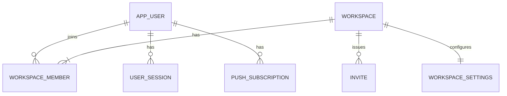
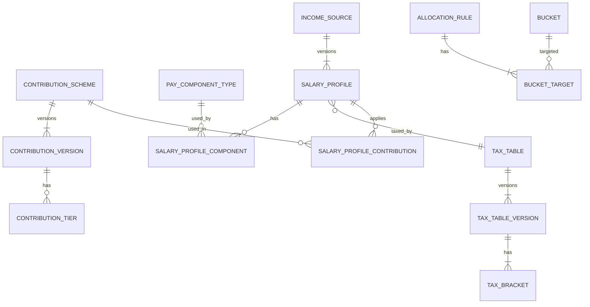
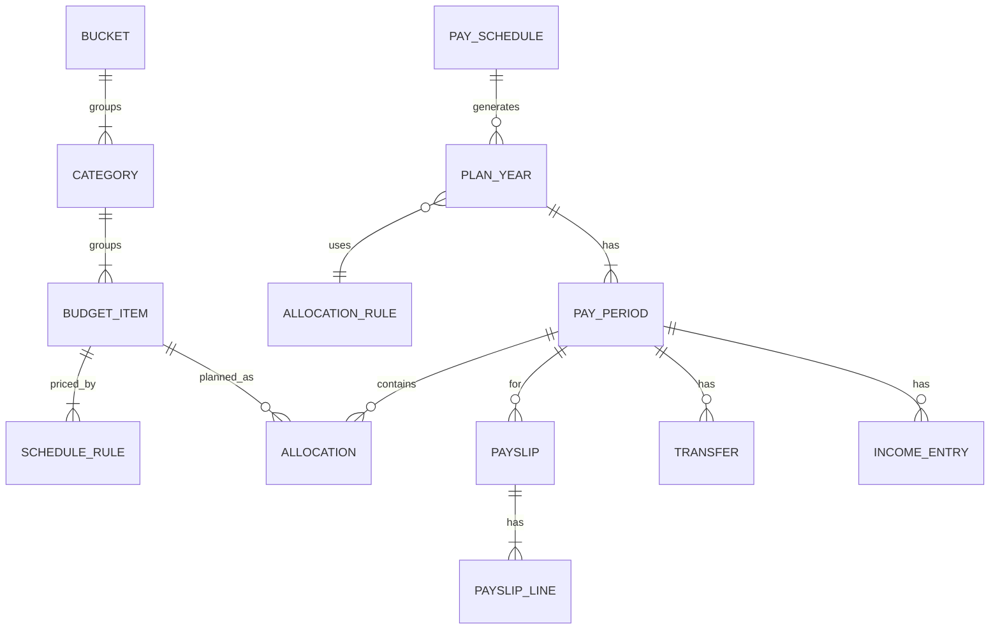
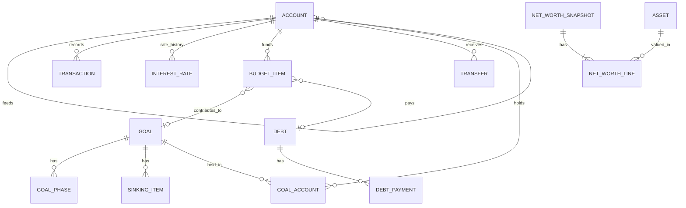

# Database Design — PostgreSQL

Part of the Phase 0 design set: [plan](cashflow-app-plan.md) · [architecture](architecture.md) · **database** · [API](api-design.md) · [UI](ui-design.md) · [engineering standards](engineering-standards.md)

---

## 1. Conventions

| Topic | Rule |
|---|---|
| Engine | PostgreSQL 17, UTF-8, `timezone = 'UTC'` |
| Access | EF Core 10 + Npgsql; `UseSnakeCaseNamingConvention()` (EFCore.NamingConventions) |
| Naming | `snake_case`, singular table names (`budget_item`), FK = `<table>_id`, PK `pk_<table>`, FK `fk_<table>_<ref>`, index `ix_<table>_<cols>`, unique `ux_…`, check `ck_…` |
| Schemas | `identity`, `config`, `plan`, `money`, `audit`, `ops` |
| Keys | `id uuid` primary key, **UUID v7** generated in the app (`Guid.CreateVersion7()`) — time-ordered, index friendly |
| Money | `numeric(18,2)`; rates/percentages `numeric(9,6)` (0.250000 = 25%); never `float`/`money` |
| Dates | `date` for business dates (pay date, effective dates); `timestamptz` for events |
| Enums | `text` + `CHECK` constraint (readable, easy to extend through migrations); mapped to C# enums with string conversion |
| Flexible parameters | `jsonb` only for method-specific parameters that are validated in the app against a versioned JSON schema (e.g., a contribution method's settings); everything queried or joined on is a real column |
| Audit columns | `created_at`, `created_by`, `updated_at`, `updated_by` on every table; `xmin` system column as EF Core concurrency token |
| Soft delete | `archived_at timestamptz null` on master data (items, accounts, categories, rule sets); transactional rows are never soft-deleted |
| Tenancy | `workspace_id uuid not null` on every tenant table (nullable only on template-capable `config` tables, see §4.2) |

---

## 2. Multi-tenancy and row-level security

```sql
alter table plan.budget_item enable row level security;

create policy tenant_isolation on plan.budget_item
  using (workspace_id = current_setting('app.workspace_id')::uuid);

-- template-capable tables: the seeded base (both owners null) is readable by everyone, writable by nobody;
-- personal templates by their owner; workspace copies by members
create policy template_read on config.tax_table for select
  using ((workspace_id is null and owner_user_id is null)
      or owner_user_id = current_setting('app.user_id')::uuid
      or workspace_id = current_setting('app.workspace_id')::uuid);
create policy template_write on config.tax_table for all
  using (owner_user_id = current_setting('app.user_id')::uuid
      or workspace_id = current_setting('app.workspace_id')::uuid)
  with check (owner_user_id = current_setting('app.user_id')::uuid
      or workspace_id = current_setting('app.workspace_id')::uuid);
-- seed rows are inserted only by migrations running as cashflow_owner
```

The migrations read the settings as `nullif(current_setting('…', true), '')::uuid`, so an unset or empty setting matches no row, and always spell out `WITH CHECK`. Every table in `config` has exactly these two policies (asserted by a catalog-scan test); child tables (versions, brackets, exemptions, tiers, targets) carry the same owner columns and policies as their parent.

- The app connects as role `cashflow_app` (not the owner, no `BYPASSRLS`). Migrations run as `cashflow_owner`.
- Each request transaction runs `set local app.workspace_id = '<id>'` through an EF Core connection interceptor.
- EF Core global query filters do the same filtering in the app, so RLS is defence in depth.

---

## 3. Entity-relationship diagrams

### 3.1 Identity and workspaces



### 3.2 Configurable rules



### 3.3 Plan and execution



### 3.4 Money



---

## 4. Tables

Audit columns and `xmin` are omitted below for brevity; every table has them.

### 4.1 `identity`

| Table | Columns | Notes |
|---|---|---|
| `app_user` | id, google_sub (text, unique), email (citext), display_name, avatar_url, deleted_at, last_sign_in_at | Keyed by Google `sub`; email kept for display and allow-list match only |
| `workspace` | id, workspace_id (= id, `ck_workspace_workspace_id`), owner_user_id → app_user, payload/nonce/key_version | One per person by default; the name lives in the encrypted payload. `workspace_id` lets the generic tenant filter, RLS policy and change feed treat it like any other encrypted row |
| `workspace_member` | workspace_id, user_id, role (`owner`/`editor`/`viewer`) | PK (workspace_id, user_id) |
| `invite` | id, workspace_id, token_hash (bytea), role, expires_at, redeemed_by_user_id, redeemed_at, revoked_at | Token shown once; only its SHA-256 hash stored |
| `workspace_settings` | workspace_id (PK), currency_code char(3), locale, time_zone, first_day_of_week, rounding_mode (`half_away_from_zero`/`half_even`), default_pay_schedule_id | All defaults overridable |
| `push_subscription` | id, user_id, endpoint, p256dh, auth, created_at | Web Push |
| `data_protection_key` | id, friendly_name, xml | ASP.NET Core Data Protection key ring |

### 4.2 `config` — the configurable rules

All tables here are **template-capable** (except the workspace-only `income_source` and `salary_profile*` tables, which are not built yet and will use `tenant_isolation`) with three ownership levels, enforced by `ck_owner`: exactly one of these is true —
- **seeded base:** `workspace_id IS NULL AND owner_user_id IS NULL` (read-only, inserted by seed migrations, plain text — public rates);
- **personal template:** `owner_user_id` set, `workspace_id` NULL (one user's reusable copy, encrypted with that user's personal key);
- **workspace copy:** `workspace_id` set, `owner_user_id` NULL (what plans use, encrypted with the workspace key).

Every copy records `source_template_id` and `source_version` (the row and version it was copied from) so the app can offer "new base version available". Seeded rows carry their own seed tag in `source_version` (e.g. `ph-base/2026.1`).

Shape shared by every table below (the tables list only their own columns):

| Column / constraint | Rule |
|---|---|
| `workspace_id uuid null` → identity.workspace, `owner_user_id uuid null` → identity.app_user | `ck_owner`: `num_nonnulls(workspace_id, owner_user_id) <= 1` (both null = base) |
| `source_template_id uuid null`, `source_version text null` | Soft reference (no FK): the source may sit in another owner's scope |
| `payload bytea null`, `nonce bytea null`, `key_version int null` | `ck_<table>_payload`: all three set or all null; `ck_<table>_nonce`: 12 bytes |
| `ck_<table>_shape` | `(payload is null) = (workspace_id is null and owner_user_id is null)`: base rows are plain and have no payload; personal templates and workspace copies always have one |
| Plain value columns (names, amounts, rates) | **Nullable**: filled on base rows, null on copies, whose values live in the payload (§10). Structural columns stay plain and not null on every row: ids and FKs, dates, enums, flags, `seq`/`sort_order`, and identifier codes (`code`, `bucket_code`, `calendar_code`, `holiday_calendar_code`, `country_code`) |
| `owner_key text` (generated: `'base'`, `'w:<workspace_id>'` or `'u:<owner_user_id>'`) | On parent/child tables only. Each child has a composite FK `(parent_id, owner_key) → parent (id, owner_key)`, so a version, bracket, exemption, tier or target always has its parent's owner — FK checks bypass RLS, so without it a workspace could hang rows under the base or under another owner's parent |
| RLS | `template_read` / `template_write` (§2) |

**Tax**

| Table | Columns | Notes |
|---|---|---|
| `tax_table` | id, name, country_code, description, method (`bracket`/`flat`/`none`), is_default | e.g., "Philippines — TRAIN (2023+)" |
| `tax_table_version` | id, tax_table_id, effective_from date, effective_to date null, period_basis (`annual`/`monthly`/`semi_monthly`/`weekly`), flat_rate numeric(9,6) null, exempt_threshold numeric(18,2) null, notes | `ex_tax_table_version_effective`: `exclude using gist (tax_table_id with =, daterange(effective_from, effective_to, '[]') with &&)` |
| `tax_bracket` | id, tax_table_version_id, seq, lower_bound, upper_bound null, base_tax, rate, applies_to (`excess_over_lower`/`whole_amount`) | `ck_tax_bracket_bounds`: upper > lower; brackets contiguous (validated in app) |

**Contributions** (SSS, PhilHealth, Pag-IBIG, or any user-defined: HMO, union dues, company retirement)

| Table | Columns | Notes |
|---|---|---|
| `contribution_scheme` | id, code, name, is_pre_tax bool, default_period_placement (`p1`/`p2`/`split`/`every`), is_enabled | |
| `contribution_version` | id, scheme_id, effective_from, effective_to, method (`percentage`/`bracket_table`/`fixed`), base (`gross`/`basic`/`custom`), employee_rate, employer_rate, floor_base, ceiling_base, base_step null (round the base to a step, e.g. SSS ₱500 MSC), min_amount, max_amount, fixed_amount, parameters jsonb | `ex_contribution_version_effective` (no overlap per scheme, as for tax versions). `parameters` holds method extras (e.g., SSS MPF split) validated by schema `contribution-params/v1` |
| `contribution_tier` | id, contribution_version_id, seq, lower_bound, upper_bound, credit_amount (e.g., MSC), employee_amount, employer_amount | For `bracket_table` method |

**Earnings, deductions and salary**

| Table | Columns | Notes |
|---|---|---|
| `pay_component_type` | id, name, kind (`earning`/`allowance`/`deduction`/`benefit`), is_taxable, is_pre_tax, counts_toward_benefit_exemption bool | e.g., Basic pay, Rice allowance, 13th month, Company loan |
| `benefit_exemption` | id, tax_table_id, effective_from, annual_cap | Template-capable child of `tax_table`; PH ₱90,000 cap for 13th month & benefits |
| `income_source` | id, workspace_id, name, type (`salary`/`freelance`/`business`/`interest`/`other`), is_active | |
| `salary_profile` | id, workspace_id, income_source_id, effective_from, effective_to, monthly_gross, tax_table_id null, tax_mode (`table`/`manual`/`none`), manual_tax_amount null, tax_split_method (`workbook`/`even`/`p1`/`p2`/`manual`), contribution_placement (`p1`/`p2`/`split`), annualize_for_tax bool | |
| `salary_profile_component` | id, salary_profile_id, pay_component_type_id, period (`p1`/`p2`/`both`/`monthly`), amount | Allowances & recurring deductions |
| `salary_profile_contribution` | salary_profile_id, scheme_id, is_enabled, override_amount null | Turn a scheme off or force an amount |

**Allocation**

| Table | Columns | Notes |
|---|---|---|
| `bucket` | id, code (`needs`/`savings`/`wants`; links `category_template.bucket_code`), name, color, sort_order, kind (`spend`/`save`) | Defaults: Needs, Savings, Wants — renameable, more can be added |
| `allocation_rule` | id, name, targets_enabled bool | Base: "50 / 30 / 20" |
| `bucket_target` | id, allocation_rule_id, bucket_id, percentage numeric(9,6) (fraction, 0.50 = 50%) | `ux (allocation_rule_id, bucket_id)`; Σ = 1 when enabled is validated in the browser (amounts are encrypted on copies, §10) |
| `pay_schedule` | id, name, frequency (`monthly`/`semi_monthly`/`bi_weekly`/`weekly`/`custom`), day1, day2, anchor_date, weekend_rule (`previous_business_day`/`next_business_day`/`none`), holiday_calendar_code null | Holidays of that calendar also move pay dates |
| `holiday` | id, calendar_code, date, name | PH calendar template, editable; `ux (calendar_code, date, workspace_id, owner_user_id)` nulls not distinct |
| `category_template` | id, bucket_code, name, sort_order, starter_items text[] null | Starter categories offered during onboarding; here rather than in `plan.category` because that table's `workspace_id` is not null |

### 4.3 `plan`

| Table | Columns | Notes |
|---|---|---|
| `plan_year` | id, workspace_id, year, pay_schedule_id, allocation_rule_id, status (`draft`/`active`/`closed`), copied_from_plan_year_id | `ux (workspace_id, year)` |
| `pay_period` | id, workspace_id, plan_year_id, seq (1..n), month, sequence_in_month, label, start_date, end_date, pay_date, status (`open`/`transfers_done`/`paid`/`closed`), closed_at | `ux (plan_year_id, seq)` |
| `category` | id, workspace_id, bucket_id, name, sort_order, archived_at | |
| `budget_item` | id, workspace_id, category_id, name, notes, funding_account_id null, goal_id null, debt_id null, sort_order, archived_at | |
| `schedule_rule` | id, workspace_id, budget_item_id, effective_from_period_id, effective_to_period_id null, period_range int4range (generated), split_mode (`even`/`p1`/`p2`/`custom`/`spread`/`once`), monthly_amount, p1_amount, p2_amount, annual_amount, active_months int (12-bit mask) | `EXCLUDE USING gist (budget_item_id WITH =, period_range WITH &&)` — needs `btree_gist` |
| `allocation` | id, workspace_id, budget_item_id, pay_period_id, planned_amount, is_override, actual_amount null, status (`planned`/`paid`/`partially_paid`/`skipped`/`carried_over`), paid_on, note | `ux (budget_item_id, pay_period_id)` |
| `payslip` | id, workspace_id, pay_period_id, income_source_id, kind (`expected`/`actual`), gross, taxable, withholding_tax, net_pay, explanation jsonb, received_on | `ux (pay_period_id, income_source_id, kind)`; `explanation` = engine trace |
| `payslip_line` | id, payslip_id, line_type (`earning`/`allowance`/`contribution`/`tax`/`deduction`), name, ref_id null, amount, is_taxable | |
| `income_entry` | id, workspace_id, pay_period_id, income_source_id, pay_component_type_id, amount, is_taxable, note | 13th month, bonus, side income |
| `transfer` | id, workspace_id, pay_period_id, from_account_id null, to_account_id, planned_amount, actual_amount, is_done, done_at | Snapshot recalculated until done |
| `notification` | id, workspace_id, user_id, kind, title, body, link, created_at, read_at | In-app inbox (no email) |

### 4.4 `money`

| Table | Columns | Notes |
|---|---|---|
| `account` | id, workspace_id, name, institution, type (`payroll`/`bank`/`ewallet`/`savings`/`time_deposit`/`investment`/`credit_card`/`loan`/`cash`), currency_code, is_funding_account, parent_funding_account_id null, opening_balance, opening_date, day_count_basis (360/365), final_tax_rate, archived_at | Self-FK; cycle check in app |
| `interest_rate` | id, account_id, effective_from, annual_rate | |
| `transaction` | id, workspace_id, account_id, date, amount (signed), type (`deposit`/`withdrawal`/`transfer_in`/`transfer_out`/`payment`/`interest`/`tax`/`fee`/`adjustment`), memo, allocation_id null, transfer_id null, counterpart_id null, import_batch_id null | `ix (account_id, date)` |
| `goal` | id, workspace_id, name, type (`sinking`/`emergency`/`medical`/`retirement`/`travel`/`house`/`custom`), target_method (`fixed`/`months_of_net_pay`/`months_of_needs`), target_amount, target_date, priority, archived_at | |
| `goal_phase` | id, goal_id, phase_no, multiplier null, target_amount null | |
| `goal_account` | goal_id, account_id, share_pct | |
| `sinking_item` | id, goal_id, name, amount, due_month, recurrence (`yearly`/`once`), note | |
| `debt` | id, workspace_id, name, type (`credit_card`/`car_loan`/`salary_loan`/`personal`/`mortgage`/`other`), lender, original_principal, start_date, annual_rate, monthly_payment, end_date, account_id | |
| `debt_payment` | id, debt_id, date, amount, principal, interest, allocation_id null | |
| `asset` | id, workspace_id, name, type (`stocks`/`crypto`/`investment`/`emoney`/`vehicle`/`property`/`other`) | |
| `net_worth_snapshot` | id, workspace_id, as_of date, total_assets, total_liabilities, net_worth | `ux (workspace_id, as_of)` |
| `net_worth_line` | id, snapshot_id, account_id/asset_id/debt_id (one set), value | `ck`: exactly one ref |

### 4.5 `audit` and `ops`

| Table | Columns | Notes |
|---|---|---|
| `audit.change_log` | id, workspace_id, user_id, entity, entity_id, action, changes jsonb (field → old/new), at | Written by an EF `SaveChanges` interceptor; partitioned by month |
| `ops.import_run` | id, workspace_id, file_name, file_sha256, started_at, finished_at, status, summary jsonb, warnings jsonb | |
| `ops.job` | id, kind, payload jsonb, run_at, attempts, locked_until, last_error, done_at | Background jobs (`FOR UPDATE SKIP LOCKED`) |

---

## 5. Indexes (beyond PK/FK)

| Index | Purpose |
|---|---|
| `allocation (workspace_id, pay_period_id)` include (planned_amount, actual_amount, status) | Payday and planner reads |
| `allocation (budget_item_id)` | Row editing |
| `pay_period (plan_year_id, pay_date)` | "Current period" lookup |
| `transaction (account_id, date)` | Balances, ADB |
| `tax_table_version (tax_table_id, effective_from desc)` | Effective-dated lookup |
| `contribution_version (scheme_id, effective_from desc)` | idem |
| `salary_profile (income_source_id, effective_from desc)` | idem |
| `notification (user_id) where read_at is null` | Unread badge |
| `invite (token_hash)` unique | Redeem |

Every FK gets an index (EF Core does this by default).

---

## 6. Seed data (the Philippine base)

Shipped as seed migrations with `workspace_id` and `owner_user_id` NULL, plain values, no payload (`ck_<table>_shape`) and fixed ids (`PhBaseSeed`), so every environment holds the same rows and copies can point at them. Each row carries the seed tag in `source_version`; the current tag, `ph-base/2026.1` (migration `202611210003_SeedPhBase2026`), is also the `ETag` of the read-only `GET /api/v1/base/*` endpoints (`Cache-Control: public, max-age=3600`). The app role cannot write them (RLS `template_write` matches no base row). There is no admin role and no screen that edits these rows; a new version (e.g. 2027 contribution rates) is a new seed migration in a release, inserted next to the old rows:

| Template | Content |
|---|---|
| Tax table "Philippines — TRAIN law" | Version from 2023-01-01, annual basis, 6 brackets (see plan Appendix A), all `excess_over_lower`; benefit exemption ₱90,000 from 2023-01-01 |
| Contribution "SSS" | Percentage method from 2025-01-01, employee 5%, employer 10%, base floor ₱5,000, ceiling ₱35,000, base step ₱500 (MSC); MPF parameters later |
| Contribution "PhilHealth" | Percentage 5% total (2.5% / 2.5%) of basic pay, floor ₱10,000, ceiling ₱100,000, from 2025-01-01 |
| Contribution "Pag-IBIG" | Percentage 2% / 2%, ceiling ₱10,000, from 2024-02-01 (when the ₱10,000 ceiling took effect) |
| Pay component types | Basic pay, Allowance (non-taxable), 13th month (benefit, counts toward the exemption), Bonus (benefit, counts toward the exemption), Overtime, Night differential, Company loan, SSS loan, Pag-IBIG loan (deductions) |
| Buckets & rule | Needs 0.50 (spend), Savings 0.30 (save), Wants 0.20 (spend); allocation rule "50 / 30 / 20" |
| Categories (optional starter, `category_template`) | The workbook's groups: House, Utilities, Groceries, Work, Car → Needs; Savings, Investments, Insurance → Savings; Subscriptions, Loans, Others → Wants |
| Pay schedule | Semi-monthly 15 / end of month (day2 = 31 clamps), previous business day, holiday calendar `PH` |
| Holiday calendar `PH` | 2026 regular holidays: New Year's Day (01-01), Maundy Thursday (04-02), Good Friday (04-03), Araw ng Kagitingan (04-09), Labor Day (05-01), Independence Day (06-12), National Heroes Day (08-31), Bonifacio Day (11-30), Christmas Day (12-25), Rizal Day (12-30) |

During onboarding a new workspace copies the base (or the user's own personal templates) for the tax table, contributions, components, buckets and schedule. Users can also create templates from scratch, at workspace level or as personal templates. When a release adds a newer base version, workspaces whose copy came from the older one see "update available" and choose to copy it in as a new effective-dated version; nothing is overwritten.

---

## 7. Migrations and data lifecycle

- EF Core code-first migrations in `Cashflow.Infrastructure/Persistence/Migrations`; one migration per PR; reviewed SQL (`dotnet ef migrations script`) attached to the PR.
- Production applies **idempotent scripts** in the deploy job after a fresh backup; app start never migrates.
- Expand → migrate → contract for breaking column changes.
- Retention: change log 3 years; jobs 30 days after done; import runs 1 year; everything else until the user deletes the workspace (hard delete with cascade, after a 30-day grace period).
- Workspace export (JSON + Excel) available any time — this is also the GDPR/Data Privacy Act "right to data portability".

---

## 8. Backups and restore

| What | How | Kept |
|---|---|---|
| Nightly logical backup | `pg_dump -Fc` → encrypted with `age` → DigitalOcean Spaces | 30 daily, 12 monthly |
| Pre-deploy backup | Same, tagged with the release | 10 |
| Droplet snapshot | DigitalOcean weekly backups | 4 |
| Restore drill | Monthly: restore latest dump into a scratch container, run `/health/ready` and row-count checks | — |

Target: RPO ≤ 24 h, RTO ≤ 2 h.

---

## 10. End-to-end encryption

Design and rationale: [privacy-encryption.md](privacy-encryption.md). Effect on the schema:

- Every column holding an **amount, rate, name or note** in §4.2–§4.5 (workspace copies and personal templates — the seeded base stays plain) moves into one encrypted column per row:

  | Column | Type | Meaning |
  |---|---|---|
  | `payload` | `bytea` | AES-256-GCM ciphertext of the row's sensitive fields as JSON |
  | `nonce` | `bytea` (12 bytes) | Unique per write |
  | `key_version` | `int` | Which workspace data key version encrypted it |

  Plain columns that stay: `id`, `workspace_id`, foreign keys, dates (`pay_date`, `effective_from`, `date`), statuses/enums, `sort_order`, `archived_at`, audit timestamps.
- Constraints that need amounts (Σ bucket targets = 100, contiguous brackets, non-overlapping schedule ranges on amounts) are enforced **in the browser** before encryption; constraints on plain columns (unique pairs, FKs, effective-date exclusion constraints) stay in PostgreSQL.
- New tables in `identity`:

  | Table | Columns |
  |---|---|
  | `user_key` | user_id (PK), public_key bytea, wrapped_private_key bytea (by unlock key), wrapped_private_key_recovery bytea, wrapped_personal_key bytea (encrypts personal templates), unlock_method (`passkey_prf`/`passphrase`), kdf_params jsonb, passkey_credential_id bytea null, created_at |
  | `workspace_key` | workspace_id, key_version, member_user_id, wrapped_wdk bytea, created_at · PK (workspace_id, key_version, member_user_id) |
  | `record_change` | workspace_id, seq bigserial, table_name, row_id, op, at · change feed for multi-device sync |

- `audit.change_log.changes` stores only field **names**, never values.
- Indexes on encrypted fields are impossible by design; queries filter by plain metadata (workspace, period, dates) and the browser does the rest.

---

## 9. Sizing

One workspace-year ≈ 24 periods × ~45 items ≈ 1,100 allocations + ~2,000 transactions + a few hundred rule rows → well under 5 MB. A 2 GB droplet holds hundreds of workspaces for years; tune `shared_buffers = 256MB`, `work_mem = 8MB`, `max_connections = 50`, and use Npgsql connection pooling (`Maximum Pool Size=20`).
