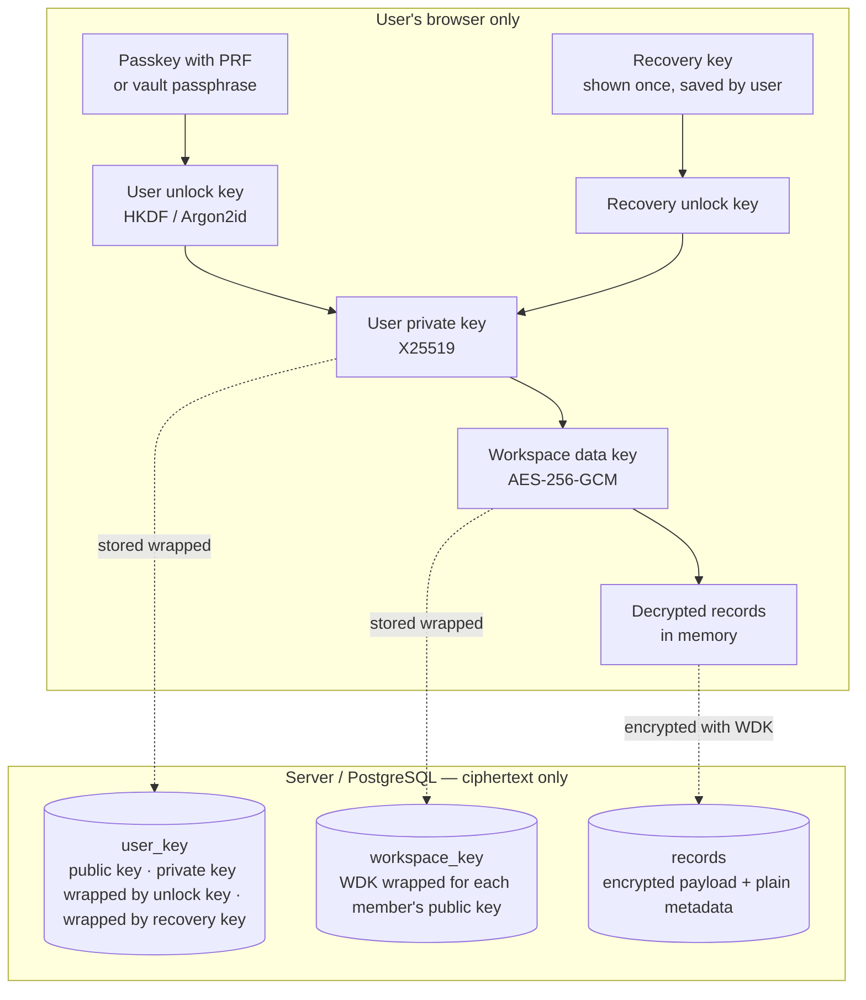

# Privacy Design — Keeping Pay Details Unreadable to the Operator

Part of the Phase 0 design set: [plan](cashflow-app-plan.md) · [architecture](architecture.md) · [database](database-design.md) · [API](api-design.md) · [UI](ui-design.md) · [engineering standards](engineering-standards.md) · **privacy**

---

## 1. The requirement

> Other people will keep their salary, tax, savings and debts in this app. **The person who runs the server (the operator, with root on the droplet and full database access) must not be able to read their financial details.** There is no admin role in the app at all.

### Why access rules are not enough

| Control | Stops other users? | Stops the operator? |
|---|---|---|
| Workspace query filters + PostgreSQL row-level security | Yes | **No** — root can connect as the table owner, bypass RLS, or read raw files |
| No admin role or "view user data" screens | Yes | **No** — the database is still readable directly |
| Server-side encryption (keys on the server, or in a cloud KMS the server can call) | Yes | **No** — whoever runs the server can make it decrypt |
| Encrypted backups | Protects stolen backups | **No** — the operator holds the backup key |
| **Client-side (end-to-end) encryption, keys only in the user's browser** | Yes | **Yes** — the server never has the keys |

So the design uses **end-to-end encryption (E2EE)** for all sensitive financial data, plus the access controls above as defence in depth.

---

## 2. What is encrypted and what is not

| Encrypted (ciphertext only on the server) | Plain (needed by the server to work) |
|---|---|
| All amounts: salary, allowances, contributions, tax, payslip lines, allocations, transfers, balances, transactions, goals, debts, net worth, interest rates of personal accounts | Ids, `workspace_id`, foreign keys |
| Names and notes the user types: item, category, account, institution, goal, debt, asset, income source, workspace name | Dates: pay dates, effective dates, `created_at` |
| Personal copies of tax tables and contribution schemes (they can reveal income level and employer arrangements) | Enum/status fields: period status, split mode, bucket kind, paid ✔ flags |
| Imported workbook content and import reports | Sort order, row versions |
| Notifications' body text (generated in the browser) | Google `sub`, email and display name (needed to sign in and to list users) |
| Workspace exports (encrypted file, or decrypted only in the user's browser) | **The seeded Philippine base** (the public PH TRAIN table, SSS/PhilHealth/Pag-IBIG rates) — public information. Personal templates and workspace copies are encrypted |

What the operator **can** still see (metadata): who has an account and when they last signed in, how many rows each workspace has, pay dates and period statuses, and the size of the encrypted data. The operator **cannot** see any amount, name or note.

---

## 3. Key design

| Key | What it is | Where it lives |
|---|---|---|
| **Workspace data key (WDK)** | Random 256-bit AES-GCM key per workspace (versioned for rotation) | Only wrapped copies on the server; plaintext only in browser memory |
| **User key pair** | X25519 (or ECDH P-256) key pair per user; ADR 0013 chose ECDH P-256 | Public key on the server; private key wrapped |
| **User unlock key** | Derived in the browser from a **passkey PRF** (WebAuthn PRF extension — Face ID / Windows Hello / phone) or a **vault passphrase** (Argon2id, 64 MB, 3 iterations) | Never leaves the browser |
| **Recovery key** | 32 random bytes shown once as a 24-word phrase / printable code | Kept by the user; only a wrapped copy of the private key exists on the server |

### Why a second unlock on top of Google sign-in?

Google sign-in proves *who you are* to the server, but the server (and therefore the operator) controls that session. Encryption needs a secret **the server never sees**. The passkey PRF gives that with one tap (no extra password); the vault passphrase is the fallback for devices without passkey PRF support.

### Flows

| Flow | What happens |
|---|---|
| **First sign-in** | Google sign-in → "Protect your data" step: create passkey (or passphrase) → browser generates key pair + WDK → shows recovery key (must confirm it was saved) → uploads only public key and wrapped keys |
| **Daily use** | Google sign-in → unlock with passkey/passphrase → browser unwraps private key → unwraps WDK → loads and decrypts records. Optional "keep unlocked on this device for 30 days" stores a device-bound non-extractable key in IndexedDB |
| **New device** | Unlock with the same synced passkey, the passphrase, or the recovery key |
| **Forgot passphrase / lost passkey** | Follow the recovery ladder below (another device → synced passkey → recovery key → trusted contact → shared workspace → export). If none works, **start over** with new keys and an empty workspace; the old data can't be recovered by anyone, including whoever runs the server. The UI says this plainly at setup |
| **Invite a member** | Owner's browser wraps the WDK with the invitee's public key after they first sign in (invite stays pending until the owner's next visit, or the owner approves on the spot) |
| **Remove a member** | Owner's browser creates a new WDK version, re-encrypts records in the background, and re-wraps for remaining members |
| **Server operator** | No in-app role. Manages the allow-list in `.env`, deploys releases (which carry base-template updates), reads server logs and metrics. Has no key and no screen that shows financial data |
| **Personal templates** | Encrypted with a per-user personal data key, wrapped by the user's own key pair; copying one into a workspace re-encrypts it with that workspace's key in the browser |

### Lost keys: recovery ladder and starting over

Sign-in (Google) and unlocking (passkey / passphrase / recovery key) are separate, so a user who loses their keys **can still sign in** — the question is only whether the old data can be decrypted. The app walks them down this ladder, in order:

| # | Path | Old data kept? | When it works |
|---|---|---|---|
| 1 | **Another unlocked device** — a phone or laptop still unlocked ("keep unlocked for 30 days") can create a new passkey/passphrase and a **new recovery key** | Yes | Any of their devices is still unlocked |
| 2 | **Synced passkey** — the same passkey on another device (iCloud Keychain, Google Password Manager, Windows) | Yes | They set up a passkey and it synced |
| 3 | **Recovery key** — the 24 words / printed PDF | Yes | They saved it |
| 4 | **Trusted contact (optional, opt-in)** — at setup the user may pick another app user (e.g. a partner). Their private key is also wrapped for that person; the contact approves a recovery request in their own unlocked app, and the user sets new keys | Yes | They enabled it and the contact approves. The contact only re-wraps the key; they never see the data unless they share a workspace |
| 5 | **Shared workspace** — if another member of a shared workspace (e.g. Household) is unlocked, they re-wrap that workspace's key for the user's new key pair | Yes, for that shared workspace only | The workspace has another member |
| 6 | **Own export file** — import a previously downloaded encrypted export (protected by its own export passphrase) or an Excel export | Up to the export date | They kept an export |
| 7 | **Start over** — "I lost my keys — start fresh": confirm twice, create new keys and an empty workspace. Old encrypted data is moved to a locked archive for **30 days** (in case the recovery key turns up), then deleted | **No** | Always available |

Rules:
- **Nobody running the server can recover anyone's data** at any step — there is no admin role and no key escrow, by design. (An "operator can recover" option was considered and rejected: it would make the operator able to read data, which defeats the purpose.)
- "Start over" also re-runs onboarding, so the user can re-import the Cash Flow workbook or start from templates.
- After any recovery, the app issues a new recovery key and asks the user to save it again; old wrapped keys are deleted.
- Reminders: a gentle prompt after 90 days, "Do you still have your recovery key?", with a one-tap "show / re-download" while unlocked.

### Algorithms

- Record encryption: **AES-256-GCM**, random 96-bit nonce per write, **associated data = `workspace_id | table | row id | key version`** so ciphertext cannot be moved to another row or workspace.
- Key wrapping (ADR 0013: ECDH P-256 in the implementation): X25519 ECDH + HKDF-SHA-256 → AES-256-GCM (HPKE-style); passphrase: Argon2id → HKDF.
- Implemented with the browser's **WebCrypto (SubtleCrypto)** via Blazor JS interop (`[JSImport]`); Argon2id via a vetted WASM library. Keys are created **non-extractable** where WebCrypto allows. No home-made cryptography — only standard primitives in standard constructions, reviewed before release.

---

## 4. What this changes in the architecture

Because the server cannot read amounts, **all calculations run in the browser**. This fits the design well: the calculation engine (`Cashflow.Domain`) is plain C# with no I/O and runs inside Blazor WebAssembly unchanged.

| Area | Before | With E2EE |
|---|---|---|
| Payroll, tax, allocation, transfers, interest, goals, debt payoff | Server handlers call the engine | **Browser** calls the engine; server stores results as encrypted records |
| Planner grid, payday, reports, dashboard | Server builds the view | Browser downloads the workspace's encrypted records (small: a few MB per year), decrypts, computes |
| API | Rich endpoints with amounts | **Encrypted-record sync API**: CRUD on records with plain metadata + `payload` ciphertext; optimistic concurrency with ETags; change feed for multi-device |
| Validation | Server validates amounts | Browser validates content (same FluentValidation rules in Contracts); server validates metadata, sizes, ownership and ciphertext format |
| Workbook import | Parsed on the server | Parsed **in the browser** (Open XML SDK in WASM); only encrypted records are uploaded |
| Background jobs | Server builds reminders and snapshots | Server sends payday reminders from **plain dates only** ("Payday today — open Cashflow"); net worth snapshots are created by the browser on the next visit |
| Search and sorting by name/amount | SQL | In the browser (data per workspace is small) |
| Backups | Contain readable data | Contain ciphertext only — safe even if leaked |
| Logs | Must avoid amounts | Server never has amounts to log |

Data model change (see [database-design.md §10](database-design.md#10-end-to-end-encryption)): each sensitive table keeps its plain metadata columns and replaces its sensitive columns with `payload bytea`, `key_version int`, `nonce bytea`.

---

## 5. What E2EE does not protect against (be honest with users)

| Residual risk | Mitigation |
|---|---|
| The operator deploys **modified app code** that steals keys from the browser | Open-source repository; images built only by GitHub Actions from tagged commits, signed (Sigstore/cosign) with an SBOM; deploy logs public to members; strict CSP and Subresource Integrity; release notes for every deploy. Users who must not trust the operator at all would need to self-host |
| A user's own device is compromised | Out of scope; passkeys and device lock help |
| Metadata reveals patterns (number of items, pay dates, activity times) | Accepted; amounts, names and notes stay hidden |
| Lost recovery key + lost unlock = permanent data loss | Clear warnings, "print recovery sheet", optional encrypted export the user keeps |

---

## 6. Operational controls (defence in depth)

- The app's database role has no `BYPASSRLS`; the owner role is used only by the migration job.
- There is no admin API or screen; an architecture test fails the build if any endpoint bypasses the workspace/user query filters (`IgnoreQueryFilters()` is banned outside seed migrations).
- Database access on the droplet only over SSH as a separate OS user; every `psql` session is logged (`log_connections`, `pgaudit` for the owner role).
- Backups are ciphertext plus a second layer of `age` encryption.
- A **privacy page** in the app explains in plain language what the operator can and cannot see (§2) and links to this design.

---

## 7. Phasing

| Phase | Privacy work |
|---|---|
| 1 — Foundations | Key hierarchy, WebCrypto interop, passkey PRF + passphrase unlock, recovery key, encrypted record format, sync API skeleton, crypto test vectors |
| 2 — MVP | All MVP tables stored as encrypted records; engine runs in the browser; import in the browser; privacy page |
| 3+ | Member sharing with key wrapping, key rotation on member removal, signed builds and published deploy log |

E2EE is part of the MVP, not a later add-on: adding it after real data exists would mean migrating every user's plaintext.

---

## 8. Tests

- Known-answer test vectors for every crypto routine (wrap/unwrap, encrypt/decrypt, AAD mismatch must fail).
- "Operator view" integration test: after a full payday flow, dump every tenant table and assert no amount, name or note appears in plaintext.
- Tamper tests: swapped ciphertext between rows/workspaces is rejected (AAD), truncated payloads rejected.
- Recovery tests: unlock with passkey, passphrase, recovery key; member add/remove with rotation.
